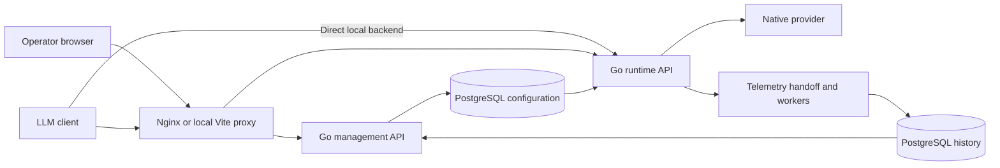

# Prism Architecture

Prism is a self-hosted gateway for native OpenAI, Anthropic, and Gemini requests. The Go backend serves the management and runtime HTTP planes, PostgreSQL owns persistent configuration and history, and the React dashboard uses the management APIs. The container combines Nginx, the dashboard, and the backend in one app image. PostgreSQL runs separately.

## Module Boundaries

| Module | Responsibility |
| --- | --- |
| [Root tooling](start.sh) | Local startup, Compose packaging, shared version, and release wiring. See [Operations](docs/operations.md) for image and launcher details. |
| [Go entrypoint](backend/cmd/prism-backend/main.go) and [platform](backend/internal/platform) | Bootstrap validation, startup migration gates, pool and service construction, middleware, worker scheduling, and shutdown. |
| [Management HTTP](backend/internal/httpapi/management) | Operator session and domain APIs for Default-profile configuration, accounts, jobs, and read models. Handlers own request and response boundaries. |
| [Runtime HTTP](backend/internal/httpapi/runtime) | Exact operation dispatch, ingress parsing, frozen planning, and request execution behind platform admission and proxy-key checks. |
| [Gateway and adapters](backend/internal/gateway) | Provider-neutral attempt and accounting behavior, with provider-specific request, response, and stream handling. |
| [Domain services](backend/internal/domain) | Routing and Ban Policy, metadata and pricing, audit, and statistics. They own domain behavior independently of HTTP response writing. |
| [Frontend](frontend/src) | TanStack Router route tree and auth gates, React feature routes, typed management API, and shared design primitives. Layout and component rules live in the [design system](frontend/DESIGN.md). |
| [Migrations](backend/migrations) | Ordered PostgreSQL schema evolution. Maintained [operator SQL](scripts/operations) has its own runbook and explicit execution entry. |

## Request and State Ownership

- The management plane resolves profile-owned objects against Default profile id `1`. Runtime requests independently freeze that profile's model, route, provider, and attribution snapshot for the full execution. `X-Profile-Id` cannot switch proxy traffic.
- The runtime matches an exact operation and model binding, resolves the direct-entry model, walks ordered Model Targets and Terminal Targets, and dispatches native calls. Container routing and client-visible backend URLs are described in [Operations](docs/operations.md). The [runtime routing contract](docs/runtime-routing.md) covers attempt order, ingress checks, provider selection, streaming, overlays, and Ban Policy.
- PostgreSQL and its durable generation counters own published configuration. Runtime cache reads validate the required generation vector. Per-process admission, retry windows, latency signals, and round-robin cursors belong to the active process and reset when it restarts.
- Accepted upstream results pass through runtime telemetry handoffs before history materialization. The statistics, capture, and retention contracts distinguish ingress, final execution, and route attempts. See [request statistics](docs/statistics.md), [audit](docs/audit.md), [log retention](docs/log-retention.md), and the [data model](docs/data-model.md).
- Browser routes use the typed management client. Resource-specific stores own their API reads, and the browser holds personal preferences separately from server-backed settings. See [dashboard contract](docs/dashboard.md) and the [Requests workflow contract](docs/requests.md).

## Dependency Direction

HTTP handlers resolve the request boundary before delegating to domain or gateway logic. Domain and gateway code use explicitly owned state and persistence boundaries. The platform owns shared connections, worker admission, and application lifecycles. PostgreSQL migrations and recoverability policy live in the [data model](docs/data-model.md#startup-migrations-and-retained-state) and the [retained-data policy](CONTRIBUTING.md#retained-data-and-compatibility-policy).

## Process Lifecycle

The backend process loads the strict bootstrap file, then runs startup under a 30-second timeout. `platform/startup/service.go` orders SQL migrations, pricing-schema transition validation, observability upgrade, the read-only OpenAI text-mode check, and legacy retention cutover before the profile, API-family audit, strategy, user-settings, client-rule, auth, endpoint-secret, and header-blocklist seeds. The Settings finalizer follows those seeds and publishes retention coverage before production services are built. A failed gate prevents the server from starting; the mode check itself is read-only, while earlier migration and upgrade steps may already have written data.

Management ownership follows the resource and lifecycle boundaries: Header Blocklist and User-Agent Client Rules each own their HTTP CRUD, validation, and persistence; Loadbalance observability separates process-local current-state reset/read, signed event query-context and event list/detail reads, incident projection, and query parsing; Audit Settings separates API-family policy/CAS CRUD from storage-summary owner facts. Shared response/decode conversion remains at each management route boundary.

Production construction creates the startup config runtime, opens six isolated PostgreSQL pools, creates the scheduler and durable background services, ensures the log partition horizon before serving traffic, creates the shared planning cache and a fresh process-local runtime-state store, builds management and runtime services, registers workers, assembles the HTTP server, and starts the scheduler before `App.Run` begins serving.

On shutdown Prism runs these phases in order: HTTP server shutdown, side-effect drains, scheduler stop, registered service closes in reverse registration order, and database-pool close. This order stops ingress first while allowing already accepted side effects a bounded drain window before worker and database resources disappear.

## Trust Boundaries

- **Operator Authentication**: Optional cookie-backed authentication for management APIs (`/api/*`). Supports username/password.
- **Proxy API Keys**: Optional API key enforcement for supported runtime operations mounted under `/v1` and `/v1beta`. Keys are issued and managed through the dashboard.
- **Auth Bifurcation**: Management auth (session cookies) and runtime auth (proxy API keys) are separate enforcement paths.
- **Data at Rest**: API keys and secrets are stored in PostgreSQL. Endpoint secrets are encrypted at rest.
- **CORS**: Local browser traffic stays same-origin through the launcher-local Vite proxy in `full` mode; standalone frontend workflows can still target an explicit backend base URL.
- **Safe failure diagnostics**: Failed attempts persist a scrubbed, 4 KiB-bounded error summary through the fixed `safediag` bottom line (Bearer/Basic/JWT/API-key-like/key=value/URL-secret redaction, control-character and whitespace normalization, metadata field scrubbing with provenance arrays) plus request-time Header Blocklist additions; stream failures keep an independent scrubbed `stream_error_detail`. Raw provider bodies are never stored in `error_detail`. The raw upstream error sample the summary is derived from is itself bounded at 32 KiB per attempt (`safediag.MaxUpstreamErrorSampleBytes`, applied as the attempt-lifecycle failed-response sample cap) and stays in memory for that derivation only: it never enters the telemetry outbox or any table. Both caps are code-fixed constants, not settings.
- **Bounded audit capture**: Audit bodies are BYTEA prefixes capped at 4 MiB per body during the copy with a 12 MiB shared request-body budget per ingress plus a 4 MiB final-response reservation; scrub provenance, observed/stored counts, and typed capture statuses are persisted. Raw downloads are byte-exact with attachment/nosniff/no-store/sandbox headers.
- **Cache safety**: All Requests/Audit list, detail, chain, body, and export responses send `Cache-Control: private, no-store` and preserve auth/profile-sensitive `Vary`; safe failure detail may still contain prompt/PII and must not enter shared caches.
- **Management CSRF**: the management browser-write guard rejects cross-origin and non-JSON `/api/*` writes (`403 management_cross_origin_write_blocked` / `415 management_unsupported_media_type`) independent of operator auth; see the [management request boundary](docs/api-reference.md#request-boundary).
- **Browser response headers**: the container nginx always sends `X-Frame-Options: DENY`, `Content-Security-Policy: frame-ancestors 'none'`, `X-Content-Type-Options: nosniff`, and `Referrer-Policy: no-referrer` on the SPA, API, and health surfaces; the CSP currently covers only `frame-ancestors`.
- **Upstream boundary**: outbound client headers are blocklisted (see [Custom Header Injection](docs/runtime-routing.md#custom-header-injection)) and upstream response headers are allowlisted before relay; transport failures surface only fixed classification labels (`upstream_connect_failed` / `upstream_tls_failed` / `upstream_dns_failed` / `upstream_timeout` / `client_disconnected` / `upstream_http_<status>` / `unknown_upstream_failure`) so callers never learn upstream host, port, path, or the refused-vs-unreachable distinction.
- **Network**: Prism does not terminate TLS and does not enforce a LAN-only boundary. Deployment exposure is the operator's responsibility: use firewall rules, reverse-proxy access controls, container or host network policy, and TLS termination appropriate to the environment.

## API Contracts

- [Shared HTTP reference](docs/api-reference.md) covers profile context, health, the management request boundary, and error envelopes.
- [Runtime API](docs/runtime-api.md) covers the operation registry and native provider wire contracts.
- [Management API](docs/management-api.md) covers authored models, catalog and client export, endpoints, targets, pricing, settings, routing, and authentication.
- [Observability API](docs/observability-api.md) covers statistics, Requests, Audit, and retention jobs.

## Product, Data, and Operations Contracts

- [Runtime routing](docs/runtime-routing.md) covers request planning, provider attempts, streaming, and Ban Policy.
- [Data model](docs/data-model.md) covers PostgreSQL schemas, ownership, lifecycle, and migration boundaries.
- [Request statistics](docs/statistics.md) covers telemetry, scopes, coverage, and the Observe read lifecycle. [Audit](docs/audit.md) covers audit capture and redaction. [Log retention](docs/log-retention.md) covers retention jobs and batch deletion. [Priority enforcement](docs/priority-enforcement.md) covers lanes, admission, and operator-facing failure modes.
- [Model and Terminal Target configuration](docs/model-configuration.md) and [load balancing](docs/load-balancing.md) cover shipped configuration, routing, failover, and schedule behavior. [Catalog, pricing import, and client export](docs/catalog-and-export.md) covers models.dev and Pi/OpenCode behavior.
- [Dashboard](docs/dashboard.md) covers browser route, session, and preference contracts. [Requests](docs/requests.md) covers the investigation and audit-content workflows.
- [Operations](docs/operations.md) covers operating the app and its dependencies, including the [direct-entry runbook](docs/operations.md#direct-request-entry-reclassification).
- [Contributing guide](CONTRIBUTING.md), [project engineering rules](CONTRIBUTING.md#project-engineering-rules), and [source responsibility rules](CONTRIBUTING.md#source-code-size-and-responsibility-rules) govern repository changes. [Product scope](CONTRIBUTING.md#product-scope) covers users, requirements, and exclusions.
- [Architecture decision records](docs/adr/) document evidenced design decisions.

## Tech Stack

| Component | Technology |
| --- | --- |
| Backend | Go 1.26.6, chi, pgx |
| HTTP Client | Go `net/http` streaming transport |
| Database | PostgreSQL via pgx |
| Frontend | React 19, Vite 8, TypeScript, Tailwind CSS 4, shadcn/ui, TanStack Router |
| API Contract | [HTTP API references](#api-contracts) |
| Communication | REST API with JSON and SSE for streaming proxy responses |

## Go Engineering Invariants

The following stable IDs bind the Go profile to the `backend` scope. The [engineering router](AGENTS.md#engineering-router) links each outcome to the applicable validation entry.

### Reproducible Entrypoints and Artifacts

Go entrypoints, configuration, toolchain, dependencies, generated inputs, tests, and release artifacts must remain determinable and reproducible from a clean checkout through repository-owned commands.

### Bounded Runtime Lifecycles

Context chains, goroutines, connections, commands, servers, and workers must propagate cancellation and deadlines and retain explicit admission, panic handling, waiting, drain, and shutdown ownership.

### Consistent Failure Semantics

Transactions, migrations, messages, caches, remote calls, retries, and cross-resource writes must preserve required consistency under duplicate delivery, timeout, cancellation, and partial failure.

### Acyclic Dependencies and Explicit Ownership

Package imports must remain acyclic, synchronous calls must terminate safely, and every authoritative fact, shared state value, and background goroutine must have one explicit owner or conflict protocol.

### Explicit Trust Boundaries

Adopted HTTP, CLI, message, file, path, identity, secret, diagnostic, limit, and public-error boundaries must be explicit, least-privilege, and covered by negative tests appropriate to their reachable risk.
