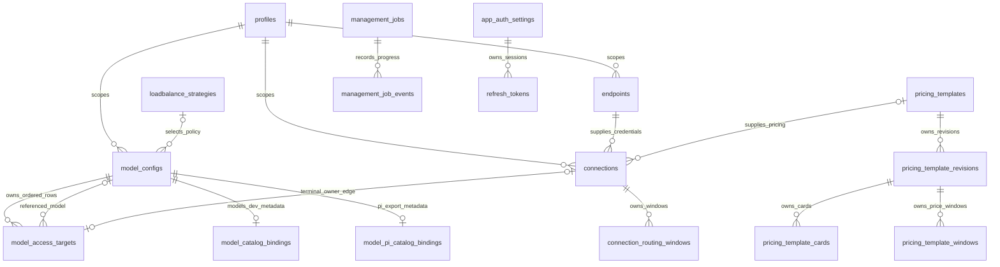

# Data Model Reference

Scope: profile-isolated runtime and management model with pricing templates, profile-scoped explicit Ban Policy routing, retained compatibility hot-state schema, process-local runtime state, endpoint label snapshots, and user-agent client rules.

## 1. Entity Relationship Diagram



Each access-target row points to either a Model Target or a Terminal Target. A Terminal Target has at most one owner edge; runtime excludes orphan compatibility rows. `position` belongs to the owner's complete mixed target list, and both target types share that order.

`request_logs`, `usage_request_events`, `audit_logs`, and `loadbalance_events` retain immutable profile attribution in daily partitions. Request/usage model, Terminal Target, endpoint, and proxy-key snapshots do not require the current configuration to exist. Audit-to-request references are weak metadata so their retention lifetimes remain independent. Process-local routing state is separate from these historical tables and from the retained compatibility state/lease tables.

## 2. Table Definitions

### 2.1 `profiles`

Profiles are retained storage namespaces. Multi-profile management is frozen: management reads and writes are pinned to Default profile id `1`, while runtime loads the published Default profile id `1` snapshot.

| Column | Type | Constraints | Description |
| --- | --- | --- | --- |
| id | INTEGER | PK, sequence-backed | Unique identifier |
| name | VARCHAR(200) | NOT NULL, UNIQUE | Profile name |
| description | TEXT | NULLABLE | Optional description |
| is_active | BOOLEAN | NOT NULL | Runtime-active marker; application-managed seed value |
| is_default | BOOLEAN | NOT NULL | Seeded default marker; application-managed seed value |
| is_editable | BOOLEAN | NOT NULL | Editable flag; current startup invariants keep the system default profile editable |
| version | INTEGER | NOT NULL | Retained concurrency token; application-managed value |
| deleted_at | TIMESTAMPTZ | NULLABLE | Soft-delete marker for inactive rows |
| created_at | TIMESTAMPTZ | NOT NULL | Creation timestamp; application-managed |
| updated_at | TIMESTAMPTZ | NOT NULL | Last update timestamp; application-managed |

Constraints and lifecycle rules:

- At most one row can have `is_active = true`; the partial unique index is not scoped by `deleted_at`.
- Startup invariants ensure Default profile id `1` exists and remains editable.
- Profile create, update, activate, and delete management routes are not exposed while multi-profile management is frozen.

### 2.2 `model_configs` (profile-scoped)

Maps a model ID to fixed api family and routing behavior within one profile.

| Column | Type | Constraints | Description |
| --- | --- | --- | --- |
| id | INTEGER | PK, sequence-backed | Unique identifier |
| profile_id | INTEGER | FK -> profiles.id, NOT NULL | Owning profile |
| api_family | VARCHAR(50) | NOT NULL | Fixed runtime compatibility family |
| model_id | VARCHAR(200) | NOT NULL | Model identifier (scoped by profile) |
| display_name | VARCHAR(200) | NULLABLE | Human-readable name |
| loadbalance_strategy_id | INTEGER | NULLABLE, FK -> loadbalance_strategies.id | Strategy used while planning this model's targets |
| openai_accepted_format | TEXT | NULLABLE | OpenAI model ingress contract: `responses_only`, `chat_completions_only`, or `dual_native`; non-OpenAI models persist `NULL` |
| openai_image_operations | TEXT | NULLABLE | OpenAI image operations accepted by the model; non-OpenAI models persist `NULL` |
| direct_request_enabled | BOOLEAN | NOT NULL, DEFAULT TRUE | Whether clients may address this model ID as a direct runtime entry; false rows remain recursive Model Target nodes |
| is_enabled | BOOLEAN | NOT NULL | Runtime availability; create defaults omitted values to `false` in application code |
| created_at | TIMESTAMPTZ | NOT NULL | Creation timestamp; application-managed |
| updated_at | TIMESTAMPTZ | NOT NULL | Last update timestamp; application-managed |

Constraints:

- `UNIQUE(profile_id, model_id)`.
- OpenAI models require at least one dimension: `openai_accepted_format` (`responses_only`, `chat_completions_only`, or `dual_native`) or `openai_image_operations` (`generations`, `edits`, or `generations_and_edits`). Pure image models keep text format `NULL`; non-OpenAI models keep both dimensions `NULL`.
- Strict mode equality: every persisted OpenAI relation (model to model, model to Terminal Target) must connect identical modes only; the management API rejects cross-mode authoring with `422 target_openai_mode_mismatch` and blocks mode changes that would break existing relations with `409`. The startup `openai_text_mode_check` step enforces the same invariant over persisted rows, including disabled/inactive relations.
- Public model authoring uses ordered rows in `model_access_targets` to reach same-family model targets. Internal connection target rows own and route to Terminal Targets, Prism's product-facing model-private endpoint bindings.
- Runtime compatibility is checked against `api_family`.
- Exact facade routing, model-owned context capability, and overflow-promotion authoring fields are retired.

### 2.3 `model_access_targets` (profile-scoped model access metadata)

Ordered access targets. Public authoring creates same-family model targets only. Internal connection targets are terminal ownership and routing edges from one source model to one Terminal Target, while model targets may chain until a Terminal Target is reached.

| Column | Type | Constraints | Description |
| --- | --- | --- | --- |
| id | INTEGER | PK, sequence-backed | Unique identifier |
| profile_id | INTEGER | FK -> profiles.id, NOT NULL | Owning profile |
| source_model_config_id | INTEGER | FK -> model_configs.id, NOT NULL, ON DELETE CASCADE | Model owning the target list |
| target_type | VARCHAR(20) | NOT NULL, CHECK IN (`model`, `connection`) | Target discriminator |
| target_model_config_id | INTEGER | FK -> model_configs.id, NULLABLE, ON DELETE RESTRICT | Optional model target |
| target_connection_id | INTEGER | FK -> connections.id, NULLABLE, ON DELETE RESTRICT | Optional Terminal Target ownership and routing edge |
| position | INTEGER | NOT NULL, CHECK >= 0 | Zero-based contiguous authoring order |
| is_enabled | BOOLEAN | NOT NULL | Whether this ordered peer participates in routing; application-managed value |
| created_at | TIMESTAMPTZ | NOT NULL | Creation timestamp; application-managed |
| updated_at | TIMESTAMPTZ | NOT NULL | Last update timestamp; application-managed |

Constraints:

- `UNIQUE(source_model_config_id, position)` is the deferrable `uq_model_access_targets_source_position` constraint.
- `target_type` is `model` or `connection`, and each row references exactly one matching target model or target connection.
- Source and target rows must stay in the same profile and same `api_family`.
- Positions are normalized and validated as contiguous `0..N-1` across both target types in management contracts; creates append to the global mixed tail, delete compacts across types, enable/disable never moves a row, and `PATCH .../position` moves within the complete mixed list.
- Position is an ordering key only, not priority, tier, or weight. Duplicate positions reject before write.
- Obsolete public payload keys `weight` and `target_priority` reject in management model APIs. The fresh schema has no columns for those values. `connections.priority` remains a legacy read-compatibility column and never participates in access-target ordering.
- Runtime routing evaluates enabled mixed rows of both types by flat `position` and stable IDs: `single`, `fill-first`, and `round-robin` act on the same mixed peer set, Model Target rows recurse through the child model's own strategy, and direct Terminal rows contribute their own attempt.
- Go management validation rejects self-reference, cross-profile targets, cross-api-family targets, and cycles; these relationship semantics are not enforced by database triggers.

### 2.2A `model_catalog_bindings` (management-only models.dev metadata)

One optional binding row per model carrying the fixed official models.dev offering coordinates plus two independent metadata projections. Catalog metadata is management-only presentation state: it never participates in `api_family` compatibility truth, capability gating, routing, or the runtime snapshot, and writes to this table never invalidate planning.

| Column group | Contents | Notes |
| --- | --- | --- |
| Coordinates | `provider_id`, `catalog_model_id`, `match_source`, `catalog_revision` (catalog ETag), `fetched_at` | `match_source` is `unique_match` or `manual`. One row per `model_config_id` (PK, FK -> model_configs ON DELETE CASCADE). Refreshes never re-guess coordinates |
| `source_*` | name/description/family/release_date/last_updated/knowledge, capability booleans, modalities JSONB arrays, limit bigints, `open_weights`, `status` | Replaced wholesale by explicit refreshes only; absent values stay NULL and explicit zeros stay `"0"`-equivalent typed values |
| `override_*` | The same field set, all nullable | Written only by operator overrides; refreshes never touch them; an explicit null override restores that field to its source value |
| Stamp | `updated_at` | Advanced on every write |

Constraints: CHECKs restrict statuses to the alpha/beta/deprecated enum, require modalities columns to be JSON arrays when present, and keep limits non-negative.

### 2.2B `model_pi_catalog_bindings` (management-only pi.dev export binding)

One optional binding row per model freezing the selected pi.dev candidate coordinate for the [Pi client export](management-api.md#13b-client-model-configuration-export) plus two independent metadata projections of its seven safe leaves. Independent of `model_catalog_bindings` above: neither table reads, rewrites, or reuses the other. This binding never participates in `api_family` compatibility truth, capability gating, routing, or the runtime snapshot; writes never invalidate planning.

| Column group | Contents | Notes |
| --- | --- | --- |
| Coordinates | `provider_id`, `catalog_model_id`, `api`, `prism_model_id_at_bind`, `bind_source`, `catalog_revision` (`sha256-…`, verified against the response body), `fetched_at` | `bind_source` is `single_candidate` or `manual`. One row per `model_config_id` (PK, FK -> model_configs ON DELETE CASCADE). `api` is CHECKed against the four Pi API literals. `prism_model_id_at_bind` is the non-null, non-empty Prism identity frozen at bind time; it is deliberately not CHECKed equal to `catalog_model_id`, because an explicit cross-directory bind makes them differ on purpose |
| `source_*` | `name` (text), `reasoning` (bool), `input` (JSONB array), `context_window`/`max_tokens` (bigint), `thinking_level_map` (JSONB object), `compat` (JSONB object), plus non-null JSONB-array `source_dropped_fields` | Replaced wholesale only by `pi/refresh/commit`; absent values stay NULL, while dropped paths remain sorted evidence and never render |
| `override_*` | The same seven fields, all nullable | Written only by `PUT .../pi/override`, validated through the same Pi 0.84.3 schema `RenderPi` enforces; refreshes never touch them; an explicit null override restores that field to its source value |
| Stamp | `updated_at` | Monotonic optimistic-lock token advanced on every actual write and required by refresh commit together with coordinate/API/revision |

Constraints: CHECKs restrict `api` to the four Pi API literals and `bind_source` to `single_candidate`/`manual`, require the metadata JSONB columns to be arrays/objects as applicable, require `source_dropped_fields` to be an array, require `prism_model_id_at_bind` to be non-empty, and keep every non-null `context_window`/`max_tokens` value positive as required by Pi 0.84.3. `000028_model_pi_binding_identity.sql` adds that snapshot column, backfills it from `catalog_model_id`, then makes it `NOT NULL`; it adds no unique constraint, so several Prism models may still reference one directory coordinate.

### 2.4 `loadbalance_strategies` (profile-scoped reusable routing behavior)

Reusable explicit Ban Policy strategy objects attached by models within one profile.

| Column | Type | Constraints | Description |
| --- | --- | --- | --- |
| id | INTEGER | PK, sequence-backed | Unique identifier |
| profile_id | INTEGER | FK -> profiles.id, NOT NULL | Owning profile |
| name | VARCHAR(200) | NOT NULL | Strategy name (profile-unique) |
| legacy_strategy_type | VARCHAR(32) | NOT NULL, CHECK IN (`single`, `fill-first`, `round-robin`) | Routing subtype |
| failure_status_codes | INTEGER[] | NOT NULL | Status codes that count as retry-window failures |
| reroute_status_codes | INTEGER[] | NOT NULL, DEFAULT `{400}`, CHECK 4xx except `429`, CHECK disjoint from `failure_status_codes` | Request-scoped rejection codes that move the same request to the next candidate without runtime failure feedback |
| ban_mode | VARCHAR(20) | NOT NULL | `off`, `temporary`, or `until_reset` |
| retry_base_delay_ms | INTEGER | NOT NULL | First retry-window delay in milliseconds |
| retry_backoff_multiplier | DOUBLE PRECISION | NOT NULL | Backoff multiplier |
| retry_jitter_ratio | DOUBLE PRECISION | NOT NULL | Retry-window jitter ratio |
| retry_max_delay_ms | INTEGER | NOT NULL | Maximum retry-window delay in milliseconds |
| cycle_retry_attempt_limit | INTEGER | NOT NULL | Inclusive retry-cycle exhaustion limit |
| ban_cumulative_retry_attempt_threshold | INTEGER | NOT NULL | Inclusive cumulative retry threshold for Ban Policy bans, or zero when `ban_mode = off` |
| ban_duration_seconds | INTEGER | NOT NULL | Temporary ban duration, or zero when mode requires no duration |
| created_at | TIMESTAMPTZ | NOT NULL | Creation timestamp; application-managed |
| updated_at | TIMESTAMPTZ | NOT NULL | Last update timestamp; application-managed |

Constraints and lifecycle rules:

- `UNIQUE(profile_id, name)`.
- Effective runtime policy resolves once per request from the attached strategy row.
- Supported routing families are `single`, `fill-first`, and `round-robin`.
- Ban Policy fields carry failure status codes, retry-window delay/backoff/jitter tuning, `cycle_retry_attempt_limit`, `ban_cumulative_retry_attempt_threshold`, and ban duration semantics.
- `reroute_status_codes` is request-scoped routing, not Ban Policy: it never writes runtime state. Migration `000035` gave retained strategies `{400}`, or `{}` when their failure status codes already contained `400`.
- Retry-cycle exhaustion is inclusive at `cycle_retry_attempts >= cycle_retry_attempt_limit`.
- Ban creation is inclusive at `cumulative_retry_attempts >= ban_cumulative_retry_attempt_threshold`; Prism does not derive the ban threshold from the cycle limit.
- `ban_mode = off` requires threshold and duration `0`; `temporary` requires threshold `>= cycle_retry_attempt_limit` plus positive duration; `until_reset` requires threshold `>= cycle_retry_attempt_limit` plus duration `0`.
- The loadbalance strategies page exposes a `Create Defaults` action that explicitly creates `Default single routing`, `Default fill-first routing`, and `Default round-robin routing` for Default profile id `1`.
- Strategies cannot be deleted while attached to one or more models.

### 2.5 `endpoints` (profile-scoped credentials)

Reusable credential objects scoped to one profile.

| Column | Type | Constraints | Description |
| --- | --- | --- | --- |
| id | INTEGER | PK, sequence-backed | Unique identifier |
| profile_id | INTEGER | FK -> profiles.id, NOT NULL | Owning profile |
| name | VARCHAR(128) | NOT NULL | Endpoint label; Unicode character limit |
| base_url | VARCHAR(512) | NOT NULL | Upstream base URL |
| api_key | VARCHAR(500) | NOT NULL | Prism-at-rest encrypted endpoint secret |
| api_key_fingerprint | VARCHAR(18) | NULLABLE | Non-secret key identity displayed by management reads |
| api_key_updated_at | TIMESTAMPTZ | NULLABLE | Most recent key-identity change |
| config_revision | BIGINT | NOT NULL, DEFAULT 1 | Endpoint configuration revision |
| created_at | TIMESTAMPTZ | NOT NULL | Creation timestamp; application-managed |
| updated_at | TIMESTAMPTZ | NOT NULL | Last update timestamp; application-managed |

Constraints and indexes:

- `UNIQUE(profile_id, name)`.
- Endpoint ordering is `lower(name), name, id`; migration `000004_endpoint_reference_metadata` removes the old display-only `position` column and index. Its name narrowing fails closed when a retained name exceeds 128 characters; it never truncates names.

### 2.6 `connections` (profile-scoped Terminal Target storage)

Terminal Targets are represented as `connections` / `connection_id` in the compatibility API and database schema. Each compatibility connection row is owned by exactly one model through `model_access_targets.target_connection_id`, while endpoints remain reusable across many Terminal Targets.

| Column | Type | Constraints | Description |
| --- | --- | --- | --- |
| id | INTEGER | PK, sequence-backed | Unique identifier |
| profile_id | INTEGER | FK -> profiles.id, NOT NULL | Owning profile |
| api_family | VARCHAR(50) | NOT NULL | Runtime compatibility family used for same-family target validation |
| endpoint_id | INTEGER | FK -> endpoints.id, NOT NULL | Referenced endpoint |
| upstream_model_id | VARCHAR(200) | NULLABLE, CHECK NULL or non-blank | Exact provider model identity for this Terminal Target; nullable only for orphan compatibility rows, while every owner-backed management/runtime target returns or requires a concrete non-blank value |
| pricing_template_id | INTEGER | FK -> pricing_templates.id, NULLABLE, ON DELETE RESTRICT | Assigned pricing template |
| qps_limit | INTEGER | NULLABLE | Per-Terminal Target QPS cap; `NULL` means unlimited |
| max_in_flight_non_stream | INTEGER | NULLABLE | Concurrent non-stream request cap; `NULL` means unlimited |
| max_in_flight_stream | INTEGER | NULLABLE | Concurrent stream request cap; `NULL` means unlimited |
| is_active | BOOLEAN | NOT NULL | Application-managed. Required for a connection to be a routing candidate, but no longer sufficient on its own: a connection with a routing schedule must also be inside one of its windows. The two are orthogonal and ordered — an inactive connection never reaches the planning snapshot, so its schedule is not evaluated at all |
| priority | INTEGER | NOT NULL | Legacy fallback ordering hint for family-level reads; model routing order comes from access-target `position` |
| name | TEXT | NULLABLE | Optional Terminal Target label |
| auth_type | VARCHAR(50) | NULLABLE | Optional auth behavior metadata |
| custom_headers | TEXT | NULLABLE | JSON headers applied before blocklist filtering |
| custom_request_parameters | JSONB | NULLABLE | Optional static top-level JSON object overlaid onto every upstream attempt body; `NULL`/`{}`/`null` all mean unconfigured; CHECK constraint `connections_custom_request_parameters_object` requires `NULL` or a JSON object root |
| health_status | VARCHAR(20) | NOT NULL | `unknown`, `healthy`, `unhealthy`; application-managed compatibility value |
| health_detail | TEXT | NULLABLE | Retained compatibility health detail |
| last_health_check | TIMESTAMPTZ | NULLABLE | Retained compatibility health timestamp |
| openai_probe_endpoint_variant | VARCHAR(40) | NULLABLE | Retained schema field for existing rows; the live UI no longer writes this metadata |
| openai_text_capability | TEXT | NULLABLE | OpenAI Terminal Target text runtime capability: `responses_only`, `chat_completions_only`, or `dual_native`; non-OpenAI Terminal Targets persist `NULL` |
| openai_image_capability | TEXT | NULLABLE | OpenAI Terminal Target image runtime capability; must cover the owner model's `openai_image_operations` and may serve more; non-OpenAI Terminal Targets persist `NULL` |
| monitoring_probe_interval_seconds | INTEGER | NOT NULL, DEFAULT 300 | Reserved monitoring cadence field |
| routing_schedule_timezone | VARCHAR(100) | NULLABLE | IANA timezone of this Terminal Target's own routing clock; `NULL` together with zero window rows means no time restriction. Unrelated to `user_settings.timezone_preference` |
| created_at | TIMESTAMPTZ | NOT NULL | Creation timestamp; application-managed |
| updated_at | TIMESTAMPTZ | NOT NULL | Last update timestamp; application-managed |

Management read APIs mask values whose header name matches the fixed `safediag` sensitive-name rules, returning the `__prism_redacted__` sentinel plus a `custom_headers_redacted` name list; writing the sentinel back preserves the stored value, and a sentinel for an unknown header name is rejected with 422.

Indexes include `idx_connections_profile_family_active_priority` for family-scoped active candidate reads, `idx_connections_endpoint_id` for endpoint dependency checks, and `idx_connections_pricing_template_id` for template dependency checks.

Connection invariants:

- `api_family` is the compatibility source for access-target validation and runtime planning.
- Product-facing routing surfaces present these rows as Terminal Targets while persisted compatibility remains `connections` and `target_type = "connection"`.
- A connection can be referenced by exactly one model access target in the same profile.
- The partial unique index `uq_model_access_targets_connection_owner` enforces one owner for every non-null `target_connection_id`.
- Public model target authoring cannot attach Terminal Targets by ID. Model detail creates, updates, reorders, and deletes Terminal Targets through model-scoped routes.
- Deleting a Terminal Target removes its owning `model_access_targets.target_connection_id` row in the same operation.
- Connection create/update contracts do not allow client-written `priority`; model-specific ordering changes flow through `/api/models/{model_config_id}/targets/{target_id}/position`.
- OpenAI Terminal Targets require at least one of `openai_text_capability` or `openai_image_capability`. Pure image targets keep the text dimension `NULL`; non-OpenAI targets keep both dimensions `NULL`.
- `openai_text_capability` is the connection-owned OpenAI text runtime capability source of truth for planning. `responses_only` supports native Responses generation and Responses adjunct operations, `chat_completions_only` supports native Chat Completions, and `dual_native` supports both native text generation shapes. Strict mode equality requires the requested model's `openai_accepted_format` and the connection's `openai_text_capability` to be exactly equal; authoring any unequal relation is rejected by management (`422 target_openai_mode_mismatch`), mode changes that would break existing relations return `409`, and runtime skips mode-different connections in authored order so later equal-mode attempts remain eligible. An otherwise eligible set exhausted only by mode incompatibility returns the typed `400 openai_request_translation_unsupported` before provider transport; ordinary availability exhaustion without such an attempt remains `503`.
- `openai_probe_endpoint_variant` is retained for existing rows; live Terminal Target authoring uses `openai_text_capability` for OpenAI runtime planning.
- A connection with zero rows in `connection_routing_windows` has no time restriction and routes exactly as it did before routing schedules existed. Existing rows migrated with `routing_schedule_timezone` `NULL` and no window rows, so the feature is inert until configured.
- `routing_schedule_timezone` and the window rows are written and cleared together. A timezone with no windows, or windows with no timezone, is refused by the write paths and compiles to an unresolvable schedule at runtime, which excludes only that one connection.

### 2.6A `connection_routing_windows` (profile-scoped routing windows)

Half-open `[start_minute, end_minute)` intervals during which a Terminal Target may be selected. Appended as 2.6A rather than renumbering the sections that follow.

| Column | Type | Constraints | Description |
| --- | --- | --- | --- |
| id | BIGINT | PK, GENERATED ALWAYS AS IDENTITY | Unique identifier; carries no inbound foreign key and never reaches the wire |
| connection_id | INTEGER | NOT NULL, FK → connections(id, profile_id) ON DELETE CASCADE | Owning Terminal Target |
| profile_id | INTEGER | NOT NULL | Profile scope, part of the composite foreign key |
| weekday_mask | SMALLINT | NOT NULL, CHECK 1–127 | ISO weekday bitmap, bit0 = Monday; names the day the window opens on |
| start_minute | SMALLINT | NOT NULL, CHECK 0–1439 | Local wall-clock minute the window opens |
| end_minute | SMALLINT | NOT NULL, CHECK 1–2880, `> start_minute`, span ≤ 1440 | Local wall-clock minute the window closes; above 1440 continues into the next day |
| created_at | TIMESTAMPTZ | NOT NULL | Creation timestamp; application-managed |
| updated_at | TIMESTAMPTZ | NOT NULL | Last update timestamp; application-managed |

Index `idx_crw_profile_connection` on `(profile_id, connection_id)` serves the batch reads, which are always profile-scoped.

Routing window invariants:

- `ON DELETE CASCADE` is intentional and follows the runtime-state and lease tables: a window is part of a connection rather than a reference to one, so deleting the connection must take its windows with it.
- Rows are rewritten whole on every schedule write. A wire window has no stable identity, the row count is bounded at 32, and the PATCH contract is whole-field replacement, so a delete-then-insert matches the contract exactly.

### 2.7 `pricing_templates` (profile-scoped reusable token pricing identity)

`pricing_templates` is the logical, profile-scoped identity that can be attached to many Terminal Targets. It intentionally contains no price columns: the append-only `pricing_template_revisions` table below is the sole price source. The live logical row stores `id`, `profile_id`, `name`, `description`, `created_at`, `updated_at`, `current_revision_id`, `deleted_at`, and `name_identity`, with `UNIQUE(profile_id, name)` for active names. `current_revision_id` points at the current revision of the same template.

Catalog linkage: optional `catalog_provider_id` + `catalog_model_id` columns record the single models.dev offering a template was imported from. A partial unique index (`uq_pricing_templates_catalog_offering`) allows exactly one live source-linked template per offering, so repeated imports of the same offering reuse that template instead of creating duplicates.

### 2.7A `pricing_template_revisions` (append-only typed revision)

A revision is the immutable metadata and selector boundary. `template_kind` is `standard`, `tiered`, or `peak_valley` and is never combined with another kind. Price values live only in `pricing_template_cards`; schedule rows live only in `pricing_template_windows`.

| Revision field | Meaning |
| --- | --- |
| `template_kind` | Explicit mutually-exclusive discriminator; `NOT NULL` |
| `tier_input_tokens_above` | Positive threshold only for `tiered`; selection is strict `basis > threshold` |
| `pricing_schedule_timezone` / `pricing_schedule_digest` | Required only for `peak_valley`; digest is SHA-256 of sorted duplicate-free `mask,start,end` LF rows |
| `revision_source` / `catalog_revision` | `manual` (default for retained and hand-authored rows) carries no catalog revision; `catalog` requires the source revision. Catalog imports create append-only revisions. |
| currency/revision fields | Existing epoch attribution, effective boundary, append-only provenance and version identity |

`pricing_template_cards(revision_id, template_kind, card_role, ...)` has one complete five-component card for `standard`; `tier_base` and `tier_above` for `tiered`; or `peak` and `offpeak` for `peak_valley`. Composite foreign keys and deferred revision shape guards enforce the role set and specialty NULL/configured parity. Child rows are append-only and a post-commit digest mismatch fails closed.

`pricing_template_windows(revision_id, weekday_mask, start_minute, end_minute)` uses ISO weekdays, half-open wall-clock intervals, and `end_minute > 1440` for cross-midnight windows. The union of windows selects `peak`; the complement selects `offpeak`; full-week coverage is valid and zero windows are invalid for `peak_valley`. Window evaluation uses the user-authored IANA timezone and the frozen ingress `planningReferenceNow`, never completion time. Runtime selects the complete card before usage/FX/missing-component checks and never proportionally splits a request at a boundary.

Token costing consumes canonical disjoint token components: input, cache-read input, cache-creation input, output, and reasoning. The selected card is the only price source for all five component calculations.

### 2.8 `header_blocklist_rules` (mixed scope)

Header blocklist is split between global system rules and profile-scoped user rules.

| Column | Type | Constraints | Description |
| --- | --- | --- | --- |
| id | INTEGER | PK, sequence-backed | Unique identifier |
| profile_id | INTEGER | FK -> profiles.id, NULLABLE | NULL for system rules; profile FK for user rules |
| name | VARCHAR(200) | NOT NULL | Rule label |
| match_type | VARCHAR(20) | NOT NULL | `exact` or `prefix` |
| pattern | VARCHAR(200) | NOT NULL | Header match token (case-insensitive) |
| enabled | BOOLEAN | NOT NULL | Rule enabled flag; application-managed value |
| is_system | BOOLEAN | NOT NULL | Protected global rule; application-managed value |
| created_at | TIMESTAMPTZ | NOT NULL | Creation timestamp; application-managed |
| updated_at | TIMESTAMPTZ | NOT NULL | Last update timestamp; application-managed |

Constraints:

- System rule: `is_system = TRUE` implies `profile_id IS NULL`.
- User rule: `is_system = FALSE` implies `profile_id IS NOT NULL`.
- User rule uniqueness: `UNIQUE(profile_id, match_type, pattern)`.

### 2.9 `user_settings` (profile-scoped singleton)

Per-profile costing/report display preferences.

| Column | Type | Constraints | Description |
| --- | --- | --- | --- |
| id | INTEGER | PK, sequence-backed | Unique identifier |
| profile_id | INTEGER | FK -> profiles.id, NOT NULL, UNIQUE | One row per profile |
| report_currency_code | VARCHAR(3) | NOT NULL | Spending report currency; application-managed seed value |
| report_currency_symbol | VARCHAR(5) | NOT NULL | Currency symbol; application-managed seed value |
| current_reporting_currency_epoch_id | BIGINT | NOT NULL | Current reporting-currency epoch reference |
| pricing_migration_state | VARCHAR(48) | NOT NULL | `ready` or `legacy_pricing_migration_required` |
| legacy_migration_issues | TEXT[] | NOT NULL | Retained typed migration blockers |
| pricing_template_generation | BIGINT | NOT NULL, DEFAULT 0 | Template mutation generation |
| pricing_reference_generation | BIGINT | NOT NULL, DEFAULT 0 | Assignment mutation generation |
| timezone_preference | VARCHAR(100) | NULLABLE | Preferred timezone for UI/report rendering |
| created_at | TIMESTAMPTZ | NOT NULL | Creation timestamp; application-managed |
| updated_at | TIMESTAMPTZ | NOT NULL | Last update timestamp; application-managed |

The Settings finalizer removes the three duplicated per-profile retention columns after their evidence gates pass. Global policy lives only in `log_retention_settings`; the SQL migration golden snapshot is captured before that startup finalizer.

### 2.10 Retired FX authoring

`endpoint_fx_rate_settings` belonged to the historical baseline only. Migration `000009_pricing_cost_trust_finalize` drops that authoring table after classifying its evidence. The live contract has immutable Pricing migration inventories and evidence pages; Settings cannot create, update, or delete FX mappings. Historical request/usage rows retain their own FX snapshot fields and source identity.

### 2.11 `request_logs` (partitioned immutable profile attribution)

Telemetry rows have immutable profile attribution captured at request start. Captured upstream attempts in materialized execution envelopes produce one row each. Telemetry-eligible target-resolution or native-compatibility planning failures carrying `PlanningFailure`, plus execution failures accepted by the runtime telemetry path, produce synthetic failure rows without an endpoint or connection. The table is range-partitioned by UTC `created_at` day. The partition-compatible primary key is `(created_at, id)`, with `id` still sequence-backed for lookup convenience.

| Column | Type | Constraints | Description |
| --- | --- | --- | --- |
| id | BIGINT | NOT NULL, sequence-backed, part of PK `(created_at, id)` | Unique identifier |
| profile_id | INTEGER | FK -> profiles.id, NOT NULL | Immutable profile attribution |
| model_id | VARCHAR(200) | NOT NULL | Model ID used for attempt |
| resolved_target_model_id | VARCHAR(200) | NULLABLE | Final target model selected for the attempt |
| upstream_model_id | VARCHAR(200) | NULLABLE, CHECK NULL or non-blank | Request-time provider model identity for a real upstream attempt; `NULL` for planning, admission, legacy, and pre-000031 rows |
| api_family | VARCHAR(50) | NOT NULL | Fixed runtime compatibility family |
| ingress_request_id | VARCHAR(36) | NULLABLE | Prism-generated incoming request grouping ID |
| attempt_number | INTEGER | NULLABLE | Per-ingress attempt order, starting at 1 |
| operation_name | VARCHAR(120) | NULLABLE | Ingress canonical operation name; runtime writers populate it for supported operations |
| upstream_operation_name | VARCHAR(120) | NULLABLE | Provider-facing operation name used for the attempt |
| operation_translation_mode | VARCHAR(80) | NULLABLE | Current writes use `none`/NULL; retired translation values remain readable on historical rows |
| upstream_request_path | VARCHAR(500) | NULLABLE | Sanitized provider-facing operation path |
| provider_correlation_id | VARCHAR(255) | NULLABLE | Best-effort provider-visible correlation ID |
| endpoint_id | INTEGER | NULLABLE | Endpoint snapshot |
| connection_id | INTEGER | NULLABLE | Executed connection snapshot |
| selected_terminal_target_id | INTEGER | NULLABLE | Planner-selected terminal target before execution or no-fit rejection |
| proxy_api_key_id_snapshot | BIGINT | NULLABLE | FK-free request-time proxy-key identity |
| proxy_api_key_attribution_state | VARCHAR(24) | NOT NULL, DEFAULT `unknown` | `identified`, `none`, or `unknown` |
| proxy_api_key_auth_enforced_at_request | BOOLEAN | NULLABLE | Request-time proxy authentication policy |
| proxy_api_key_name_snapshot | VARCHAR(200) | NULLABLE | Display-name snapshot for the proxy key at request time |
| endpoint_base_url | VARCHAR(500) | NULLABLE | Endpoint base URL snapshot |
| endpoint_description | TEXT | NULLABLE | Compatibility endpoint-name snapshot text |
| row_kind | VARCHAR(24) | NOT NULL | Row scope: `planning`, `admission`, `upstream`, or `legacy_unknown` (legacy projection rows) |
| upstream_status_code | INTEGER | NULLABLE | Real upstream HTTP status for `upstream` rows |
| gateway_status_code | INTEGER | NULLABLE | Synthesized gateway status for planning/admission diagnostic rows |
| legacy_status_code | INTEGER | NULLABLE | Legacy un-scoped projection kept only for pre-v2 rows |
| attempt_duration_ms | INTEGER | NULLABLE | Real attempt wall-clock duration for `upstream` rows |
| legacy_duration_ms | INTEGER | NULLABLE | Legacy mixed projection kept only for pre-v2 rows |
| attempt_trigger | VARCHAR(32) | NULLABLE | Launch trigger: `initial`, `retry_same_target`, `hedge`, `failover`, or `reroute` (launched after a request-scoped rejection) |
| attempt_result | VARCHAR(32) | NULLABLE | Attempt result: `completed`, `http_error`, `stream_error`, `transport_error`, `cancelled`, `client_disconnected`, or `unknown` |
| is_winner | BOOLEAN | NULLABLE | Whether this attempt produced the final response |
| error_source | VARCHAR(20) | NULLABLE | `prism`, `upstream`, `transport`, `client`, or `unknown` |
| error_code | VARCHAR(120) | NULLABLE | Stable bounded diagnostic code (`upstream_http_<status>`, `transport_error`, `client_disconnected`, `stream_<kind>`, `prism_<stage>_failure`, `attempt_budget_exhausted`, ...) |
| failure_stage | VARCHAR(32) | NULLABLE | `routing`, `admission`, `upstream_connect`, `upstream_response`, `stream`, or `unknown` |
| error_detail_redacted | BOOLEAN | NOT NULL, DEFAULT FALSE | Scrub flag for `error_detail` |
| error_detail_truncated | BOOLEAN | NOT NULL, DEFAULT FALSE | 4 KiB cap flag for `error_detail` |
| stream_error_detail_redacted | BOOLEAN | NOT NULL, DEFAULT FALSE | Scrub flag for `stream_error_detail` |
| stream_error_detail_truncated | BOOLEAN | NOT NULL, DEFAULT FALSE | 4 KiB cap flag for `stream_error_detail` |
| upstream_request_started | BOOLEAN | NULLABLE | Lifecycle fact: upstream request launched |
| response_headers_received | BOOLEAN | NULLABLE | Lifecycle fact: upstream response headers arrived |
| first_body_or_stream_event_seen | BOOLEAN | NULLABLE | Lifecycle fact: first body/stream event delivered |
| metadata_redacted_fields | TEXT[] | NOT NULL, DEFAULT '{}' | Ordinary metadata field names scrubbed at write time |
| metadata_truncated_fields | TEXT[] | NOT NULL, DEFAULT '{}' | Ordinary metadata field names truncated at write time |
| url_scrub_provenance | VARCHAR(32) | NOT NULL | `runtime_scrubbed`, `legacy_rescrubbed`, or `legacy_unknown` |
| caller_request_id | VARCHAR(255) | NULLABLE | Client-supplied `X-Request-ID` captured before planning |
| is_stream | BOOLEAN | NOT NULL | Streaming flag |
| input_tokens | INTEGER | NULLABLE | Base input tokens |
| output_tokens | INTEGER | NULLABLE | Base output tokens |
| total_tokens | INTEGER | NULLABLE | Provider total or derived total when available |
| success_flag | BOOLEAN | NULLABLE | Success classification |
| pricing_status | VARCHAR(20) | NOT NULL | Four-state pricing classifier: `priced`, `unpriced`, `ineligible`, or `unknown` |
| unpriced_reason | VARCHAR(50) | NULLABLE | Missing price or token-usage reason (`PRICING_DISABLED`, `MISSING_TOKEN_USAGE`, `STREAM_USAGE_UNAVAILABLE`, `MISSING_PRICE_DATA`) |
| pricing_resolution_kind | VARCHAR(50) | NULLABLE | `missing_component`, `currency_migration_required`, `unsupported_unit`, `snapshot_incoherent`, or `schedule_unresolved` |
| missing_price_components | TEXT[] | NULLABLE | Canonical component list missing from the pricing snapshot |
| pricing_evidence_trust | VARCHAR(24) | NOT NULL | `trusted` (new writer) or `legacy_untrusted` (pre-migration rows) |
| pricing_template_id_used | INTEGER | NULLABLE | Pricing template ID snapshot used for the attempt |
| pricing_template_name_snapshot | TEXT | NULLABLE | Template display-name snapshot |
| pricing_template_revision_id_used | BIGINT | NULLABLE | Template revision ID snapshot |
| pricing_version_effective_at | TIMESTAMPTZ | NULLABLE | Template version effective-at snapshot |
| reporting_currency_epoch | INTEGER | NULLABLE | Reporting-currency epoch used for canonical cost attribution |
| reasoning_tokens | INTEGER | NULLABLE | Reasoning output tokens |
| cache_read_input_tokens | INTEGER | NULLABLE | Cache-read input tokens |
| cache_creation_input_tokens | INTEGER | NULLABLE | Cache-creation input tokens |
| input_cost_micros | BIGINT | NULLABLE | Input component cost |
| output_cost_micros | BIGINT | NULLABLE | Output component cost |
| reasoning_cost_micros | BIGINT | NULLABLE | Reasoning component cost |
| cache_read_input_cost_micros | BIGINT | NULLABLE | Cache-read component cost |
| cache_creation_input_cost_micros | BIGINT | NULLABLE | Cache-creation component cost |
| total_cost_original_micros | BIGINT | NULLABLE | Total cost in original pricing currency |
| total_cost_user_currency_micros | BIGINT | NULLABLE | Total cost in reporting currency |
| currency_code_original | VARCHAR(3) | NULLABLE | Pricing currency code |
| report_currency_code | VARCHAR(3) | NULLABLE | Reporting currency code |
| report_currency_symbol | VARCHAR(5) | NULLABLE | Reporting currency symbol |
| fx_rate_used | VARCHAR(20) | NULLABLE | FX rate snapshot |
| fx_rate_source | VARCHAR(30) | NULLABLE | FX rate source |
| pricing_snapshot_unit | VARCHAR(10) | NULLABLE | Pricing unit snapshot |
| pricing_snapshot_input | VARCHAR(20) | NULLABLE | Input price snapshot |
| pricing_snapshot_output | VARCHAR(20) | NULLABLE | Output price snapshot |
| pricing_snapshot_reasoning | VARCHAR(20) | NULLABLE | Reasoning price snapshot; the actual card selected for this attempt |
| pricing_snapshot_cache_read_input | VARCHAR(20) | NULLABLE | Cache-read price snapshot |
| pricing_snapshot_cache_creation_input | VARCHAR(20) | NULLABLE | Cache-creation price snapshot |
| pricing_config_version_used | INTEGER | NULLABLE | Pricing config version used for costing |
| pricing_template_kind | VARCHAR(16) | NULLABLE | Template-family provenance |
| pricing_selection_state | VARCHAR(20) | NULLABLE | Selector evaluation state; independent from card role |
| pricing_card_role | VARCHAR(16) | NULLABLE | Card role used for costing, if any |
| pricing_selector_threshold_tokens | INTEGER | NULLABLE | Tier threshold evidence |
| pricing_selector_basis_tokens | BIGINT | NULLABLE | Exact disjoint tier basis evidence |
| pricing_schedule_decided_at | TIMESTAMPTZ | NULLABLE | Frozen planning clock instant |
| pricing_schedule_timezone | VARCHAR(100) | NULLABLE | User-authored IANA timezone |
| pricing_schedule_local_weekday / pricing_schedule_local_minute | SMALLINT | NULLABLE | Local schedule evidence |
| pricing_schedule_digest | VARCHAR(64) | NULLABLE | Canonical window digest |
| stream_outcome | VARCHAR(50) | NOT NULL, DEFAULT `not_streaming` | Stream classification: `not_streaming`, `completed`, `provider_incomplete`, `client_disconnected`, `upstream_read_error`, `upstream_ended_without_terminal`, or `unknown` |
| stream_error_kind | VARCHAR(50) | NULLABLE | Stream diagnostic kind: `client_write_failed`, `request_context_canceled`, `upstream_read_failed`, or `missing_terminal_event` |
| stream_error_detail | TEXT | NULLABLE | Sanitized request-log-detail-only diagnostic text for stream failures |
| request_path | VARCHAR(500) | NOT NULL | Requested route path |
| error_detail | TEXT | NULLABLE | Error details for failed attempts |
| caller_user_agent | TEXT | NULLABLE | Original caller user agent |
| upstream_user_agent | TEXT | NULLABLE | User-Agent sent upstream |
| completion_duration_ms | INTEGER | NULLABLE | Elapsed ingress-to-finalization duration when recorded |
| ttft_ms | INTEGER | NULLABLE | Time to first token/byte when available |
| output_rate_state | VARCHAR(20) | NULLABLE | Output-rate evidence state on the final attempt row: `measured`, `unmeasurable`, `not_applicable`, or `unknown`; NULL on intermediate attempt rows and pre-000030 history |
| output_rate_reason | VARCHAR(64) | NULLABLE | Why the state holds; NULL only for `measured` |
| output_delivery_event_count | INTEGER | NULLABLE | Observed visible text/tool-output events (measured/unmeasurable rows only) |
| output_delivery_span_ms | INTEGER | NULLABLE | First-to-last visible-output delivery span in ms (measured/unmeasurable rows only) |
| audit_enabled_at_request | BOOLEAN | NOT NULL, DEFAULT FALSE | Request-time audit enablement snapshot |
| audit_capture_bodies_at_request | BOOLEAN | NOT NULL, DEFAULT FALSE | Request-time body-capture snapshot |
| request_generation_params | JSONB | NULLABLE | Captured request-generation parameter summary |
| request_generation_params_status | VARCHAR(40) | NULLABLE | Generation-parameter capture status |
| created_at | TIMESTAMPTZ | NOT NULL, part of PK `(created_at, id)` | Attempt timestamp and partition key |

Request-log semantics:

- Each captured upstream attempt in a materialized execution envelope writes one row, not one row per incoming runtime request.
- Target-resolution/admission failures write a synthetic row with `row_kind=planning|admission` and `gateway_status_code`; runtime planning/admission failures are persisted through the telemetry path with a `prism_<stage>_failure` code.
- Earlier errors such as malformed request bodies, unknown models, and API-family mismatches do not carry `PlanningFailure` and do not write synthetic history.
- When all launched transport attempts fail and execution returns its terminal `502`, all launched attempt rows are preserved with typed `attempt_result` facts and safe transport diagnostics; `attempt_budget_exhausted` (64-launch cap) is a gateway terminal code in the usage event.
- Unsupported or wrong-method requests rejected by the operation registry write no request log, audit log, usage event, or telemetry-outbox row.
- The new writer never writes the legacy `status_code`/`response_time_ms` columns, which remain nullable projections for pre-v2 rows. `billable_flag` and `priced_flag` were removed by migration `000009`.
- `ingress_request_id` groups the rows created by one incoming runtime request.
- Output-rate evidence (000030) is written once per request on the final attempt row: the runtime classifies progressive visible text/tool-output delivery (strict per-operation allowlists for OpenAI Chat/Responses, Anthropic, and Gemini; usage, terminal, control, reasoning, and image payloads never count) and persists the same `output_rate_state`, `output_rate_reason`, `output_delivery_event_count`, and `output_delivery_span_ms` verdict to the final attempt row and the usage event. A rate is measured only for completed streams with at least two visible output events whose first-to-last span reaches 50ms, a usable output-token numerator, and no reasoning-token misalignment; non-streaming text, Images, non-text operations, incomplete streams, and insufficient evidence are `unmeasurable`/`not_applicable` with a reason. Every read surface derives tok/s only from `state=measured` rows as `output_tokens * 1000.0 / output_delivery_span_ms` and averages measured samples with equal weight; historical rows (evidence NULL) and legacy v2/provisional outbox payloads materialize as `unknown` and never enter an average. The thresholds are writer policy, never schema constraints.
- `attempt_number` preserves retry/failover ordering within that group.
- `model_id` records the requested model ID while `resolved_target_model_id` records the final target model ID selected for that attempt.
- `upstream_model_id` records the selected Terminal Target's frozen identity on every real upstream attempt. It is never reconstructed from the live connection or either logical model identity; planning, admission, legacy, and historical rows remain `NULL`.
- `operation_name` is nullable in the schema for compatibility, but materialized rows for registered operations, including synthetic failures, carry a non-empty canonical operation name. Registry rejection creates no row and therefore has no persisted operation name.
- `operation_name` and `request_path` remain ingress-led. `upstream_operation_name`, `operation_translation_mode`, and `upstream_request_path` are additive upstream attribution. Current OpenAI attempts are native and use `none`/NULL; historical translation values remain intact.
- `selected_terminal_target_id` can differ from `connection_id` when the planner selected one terminal target but execution later failed over to another attempt.
- `stream_error_detail` is exposed only by exact request-log detail reads. List and dashboard recent-activity payloads expose `stream_outcome` and `stream_error_kind` without detail text.
- Prism prices only observed usage. `STREAM_USAGE_UNAVAILABLE` marks interrupted or no-terminal stream rows where required tokens are absent; completed streams missing required usage keep `MISSING_TOKEN_USAGE`.
- Token usage fields are canonical disjoint components. `input_tokens` is base input only, `output_tokens` is base output only, and cache-read input, cache-creation input, and reasoning output stay in their split fields.
- A successful priced row persists the five concrete strings from exactly one selected card. Attempt, non-2xx, unresolved, missing-usage, and unpriced rows do not copy any card's prices. Explicit `"0"` is configured free pricing; absent/invalid card data or missing FX stays unpriced with `MISSING_PRICE_DATA`.

### 2.12 `usage_request_events` (partitioned immutable usage attribution)

Usage-event rows are the finalized source for the unified statistics snapshot. The table is range-partitioned by UTC `created_at` day and uses `(created_at, id)` as its partition-compatible primary key.

| Column | Type | Constraints | Description |
| --- | --- | --- | --- |
| id | BIGINT | NOT NULL, sequence-backed, part of PK `(created_at, id)` | Unique identifier |
| profile_id | INTEGER | FK -> profiles.id, NOT NULL | Immutable profile attribution |
| ingress_request_id | VARCHAR(36) | NOT NULL, indexed with `profile_id` | Incoming request grouping ID preserved for aggregate attribution and cross-table correlation |
| model_id | VARCHAR(200) | NOT NULL | Requested model ID |
| resolved_target_model_id | VARCHAR(200) | NULLABLE | Final target model selected for the request |
| upstream_model_id | VARCHAR(200) | NULLABLE, CHECK NULL or non-blank | Frozen identity of the executor-confirmed final/winner attempt; `NULL` when no attempt wins and on legacy/pre-000031 rows |
| api_family | VARCHAR(50) | NOT NULL | Fixed runtime compatibility family |
| operation_name | VARCHAR(120) | NULLABLE | Ingress canonical operation name; runtime writers populate it for supported operations |
| upstream_operation_name | VARCHAR(120) | NULLABLE | Provider-facing operation name for finalized attribution |
| operation_translation_mode | VARCHAR(80) | NULLABLE | Current finalized attempts use `none`/NULL; historical translation values are preserved |
| upstream_request_path | VARCHAR(500) | NULLABLE | Sanitized provider-facing operation path |
| request_path | VARCHAR(500) | NOT NULL | Ingress route path that finalized the event |
| endpoint_id | INTEGER | NULLABLE | Endpoint snapshot |
| endpoint_label_snapshot | TEXT | NOT NULL | Endpoint label captured at runtime for retained aggregate display |
| connection_id | INTEGER | NULLABLE | Executed connection snapshot |
| selected_terminal_target_id | INTEGER | NULLABLE | Planner-selected terminal target for the finalized request |
| proxy_api_key_name_snapshot | VARCHAR(200) | NULLABLE | Proxy key name at event time |
| attempt_count | INTEGER | NOT NULL, CHECK `attempt_count >= 0` | Number of real upstream launches; planning/admission-only finalized events use zero |
| expected_request_log_row_count | INTEGER | NULLABLE | Expected retained request-log rows for chain reconciliation |
| status_code | INTEGER | NOT NULL | Final HTTP status code |
| success_flag | BOOLEAN | NOT NULL | Success indicator |
| final_attempt_number | INTEGER | NULLABLE | Winning attempt ordinal |
| final_attempt_trigger | VARCHAR(32) | NULLABLE | Winning attempt trigger (`initial`, `retry_same_target`, `hedge`, `failover`, `reroute`) |
| final_target_entry_trigger | VARCHAR(32) | NULLABLE | Winning target's first entry trigger (`initial`, `failover`, `hedge`, `reroute`, `unknown`) |
| same_target_retry_occurred | BOOLEAN | NOT NULL, DEFAULT FALSE | Routing evidence: same-target retry happened |
| hedge_occurred | BOOLEAN | NOT NULL, DEFAULT FALSE | Routing evidence: parallel hedge happened |
| failover_occurred | BOOLEAN | NOT NULL, DEFAULT FALSE | Routing evidence: confirmed failover happened; a `reroute` launch does not set it |
| routing_evidence_complete | BOOLEAN | NULLABLE | Whether routing evidence is complete |
| final_error_code | VARCHAR(120) | NULLABLE | Gateway terminal code (e.g. `attempt_budget_exhausted`) |
| ingress_started_at | TIMESTAMPTZ | NULLABLE | Ingress wall-clock start from finalized evidence |
| ingress_completed_at | TIMESTAMPTZ | NULLABLE | Ingress wall-clock completion from finalized evidence |
| proxy_api_key_id_snapshot | BIGINT | NULLABLE | FK-free request-time proxy-key identity |
| proxy_api_key_auth_enforced_at_request | BOOLEAN | NULLABLE | Request-time proxy authentication policy |
| proxy_api_key_attribution_state | VARCHAR(24) | NOT NULL, DEFAULT 'unknown' | Proxy-key attribution state |
| error_source | VARCHAR(20) | NULLABLE | Final failure source |
| error_code | VARCHAR(120) | NULLABLE | Final failure code |
| failure_stage | VARCHAR(32) | NULLABLE | Final failure stage |
| pricing_status | VARCHAR(20) | NOT NULL | Four-state pricing classifier (`priced`, `unpriced`, `ineligible`, `unknown`) |
| pricing_resolution_kind | VARCHAR(50) | NULLABLE | `missing_component`, `currency_migration_required`, `unsupported_unit`, `snapshot_incoherent`, or `schedule_unresolved` |
| missing_price_components | TEXT[] | NULLABLE | Canonical missing-component list |
| pricing_evidence_trust | VARCHAR(24) | NOT NULL | `trusted` or `legacy_untrusted` |
| pricing_template_id_used | INTEGER | NULLABLE | Pricing template snapshot |
| pricing_template_name_snapshot | TEXT | NULLABLE | Template name snapshot |
| pricing_template_revision_id_used | BIGINT | NULLABLE | Template revision snapshot |
| pricing_config_version_used | INTEGER | NULLABLE | Pricing config version |
| pricing_version_effective_at | TIMESTAMPTZ | NULLABLE | Template effective-at snapshot |
| reporting_currency_epoch | INTEGER | NULLABLE | Reporting-currency epoch |
| currency_attribution | VARCHAR(24) | NOT NULL, DEFAULT `legacy_unknown` | Capture-time currency provenance: `identified` for live runtime writers; conservatively `legacy_unknown` for history predating explicit attribution |
| unpriced_reason | VARCHAR(50) | NULLABLE | Missing price or token-usage reason |
| input_tokens | INTEGER | NULLABLE | Base input tokens |
| output_tokens | INTEGER | NULLABLE | Base output tokens |
| total_tokens | INTEGER | NULLABLE | Provider total or derived total when available |
| cache_read_input_tokens | INTEGER | NULLABLE | Cache-read input tokens |
| cache_creation_input_tokens | INTEGER | NULLABLE | Cache-creation input tokens |
| reasoning_tokens | INTEGER | NULLABLE | Reasoning output tokens |
| input_cost_micros | BIGINT | NULLABLE | Input component cost |
| output_cost_micros | BIGINT | NULLABLE | Output component cost |
| cache_read_input_cost_micros | BIGINT | NULLABLE | Cache-read component cost |
| cache_creation_input_cost_micros | BIGINT | NULLABLE | Cache-creation component cost |
| reasoning_cost_micros | BIGINT | NULLABLE | Reasoning component cost |
| total_cost_original_micros | BIGINT | NULLABLE | Total cost in original pricing currency |
| total_cost_user_currency_micros | BIGINT | NULLABLE | Total cost in reporting currency |
| currency_code_original | VARCHAR(3) | NULLABLE | Pricing currency code |
| report_currency_code | VARCHAR(3) | NULLABLE | Reporting currency code |
| report_currency_symbol | VARCHAR(5) | NULLABLE | Reporting currency symbol |
| fx_rate_used | VARCHAR(20) | NULLABLE | FX rate snapshot |
| fx_rate_source | VARCHAR(30) | NULLABLE | FX rate source |
| pricing_snapshot_unit | VARCHAR(10) | NULLABLE | Pricing unit snapshot |
| pricing_snapshot_input | VARCHAR(20) | NULLABLE | Input price snapshot |
| pricing_snapshot_output | VARCHAR(20) | NULLABLE | Output price snapshot |
| pricing_snapshot_cache_read_input | VARCHAR(20) | NULLABLE | Cache-read price snapshot |
| pricing_snapshot_cache_creation_input | VARCHAR(20) | NULLABLE | Cache-creation price snapshot |
| pricing_snapshot_reasoning | VARCHAR(20) | NULLABLE | Reasoning price snapshot; the actual card selected for this event |
| pricing_template_kind | VARCHAR(16) | NULLABLE | Template-family provenance: `standard`, `tiered`, or `peak_valley` |
| pricing_selection_state | VARCHAR(20) | NULLABLE | `not_evaluated`, `not_applicable`, `selected`, or `unresolved` |
| pricing_card_role | VARCHAR(16) | NULLABLE | Selected role: `standard`, `tier_base`, `tier_above`, `peak`, or `offpeak` |
| pricing_selector_threshold_tokens | INTEGER | NULLABLE | Tier threshold only when a tier selector was evaluated |
| pricing_selector_basis_tokens | BIGINT | NULLABLE | Exact disjoint input basis for tier selection |
| pricing_schedule_decided_at | TIMESTAMPTZ | NULLABLE | Frozen ingress planning instant used by peak/valley selection |
| pricing_schedule_timezone | VARCHAR(100) | NULLABLE | User-authored IANA timezone |
| pricing_schedule_local_weekday / pricing_schedule_local_minute | SMALLINT | NULLABLE | ISO local wall-clock evidence |
| pricing_schedule_digest | VARCHAR(64) | NULLABLE | Canonical window digest used for the selector decision |
| response_time_ms | INTEGER | NULLABLE | Final attempt latency in ms |
| completion_duration_ms | INTEGER | NULLABLE | Elapsed ingress-to-finalization duration when recorded |
| ttft_ms | INTEGER | NULLABLE | Time to first token/byte when available |
| output_rate_state | VARCHAR(20) | NULLABLE | Output-rate evidence state: `measured`, `unmeasurable`, `not_applicable`, or `unknown`; NULL on pre-000030 history and legacy outbox rows read as `unknown` |
| output_rate_reason | VARCHAR(64) | NULLABLE | Why the state holds; NULL only for `measured` |
| output_delivery_event_count | INTEGER | NULLABLE | Observed visible text/tool-output events (measured/unmeasurable rows only) |
| output_delivery_span_ms | INTEGER | NULLABLE | First-to-last visible-output delivery span in ms (measured/unmeasurable rows only) |
| stream_outcome | VARCHAR(50) | NOT NULL, DEFAULT `not_streaming` | Finalized stream classification copied from the contributing request-log attempt |
| stream_error_kind | VARCHAR(50) | NULLABLE | Finalized stream diagnostic kind without detail text |
| created_at | TIMESTAMPTZ | NOT NULL, part of PK `(created_at, id)` | Event timestamp and partition key |

Usage-event semantics:

- One row captures the finalized usage event for each materialized telemetry envelope and feeds the statistics snapshot.
- `ingress_request_id` preserves the stable request-group identifier shared with the attempt-level `request_logs` rows for the same incoming runtime request.
- `upstream_model_id` is copied only from the executor-confirmed final/winner attempt. Zero-launch and no-winner events keep `NULL`, and old outbox-v2 payloads without the field materialize normally as `NULL` rather than being quarantined or inferred.
- `operation_name` is nullable in the schema for compatibility, but registered-operation envelopes materialize a non-empty canonical operation name. Operation-registry rejection creates no usage event.
- Output-rate evidence mirrors the final attempt row's verdict (000030): the same state, reason, event count, and delivery span are written to both tables, legacy outbox rows without evidence fields normalize to `unknown` with reason `unknown_missing_evidence` instead of quarantining, and statistics consumers average only `state=measured` rows.
- `proxy_api_key_name_snapshot` preserves display intent even if the key name later changes.
- Runtime label capture uses the endpoint name, then base URL, then `Endpoint N`, then `Unknown Endpoint`. Synthetic failures use `Unknown Endpoint`.
- `endpoint_label_snapshot` preserves the endpoint display label used by usage snapshots, spending, and Top Endpoints, even if the endpoint is later renamed or deleted. Public stats payloads expose this stored value as `endpoint_label`.
- Upgrade backfill prefers the latest matching request-log endpoint description, then that request log's base URL, then the current endpoint name, current endpoint base URL, `Endpoint N`, and finally `Unknown Endpoint`.
- Request-log list/detail display does not use this usage snapshot. It prefers the current endpoint name, current endpoint base URL, the request log's historical base URL, `Endpoint N`, then `Unknown Endpoint`.
- Usage events keep the final stream outcome and error kind for aggregate explanation, but not `stream_error_detail`.
- Usage events copy canonical disjoint token totals, runtime pricing results, selected-terminal-target metadata, and additive ingress/upstream operation attribution. Aggregate `cached_tokens` is derived from cache-read plus cache-creation input tokens rather than stored as its own runtime component.
- Live runtime telemetry writes `currency_attribution=identified` explicitly. Queued payloads and retained rows predating the field stay `legacy_unknown`; the finalized chain projection reads that provenance instead of re-inferring it from epoch or currency code.
- Explicit `"0"` pricing contributes zero-cost component micros on priced events. Rows with absent or invalid pricing snapshots, or missing FX data, remain unpriced with `MISSING_PRICE_DATA`.

Telemetry materialization:

- Runtime handlers hand telemetry to `runtime_telemetry_outbox` for durable or scheduled background processing; the request path does not directly insert the historical tables.
- The materializer transaction inserts `request_logs`, matching `audit_logs`, one `usage_request_events` row, and proxy-key usage together, then deletes the processed outbox row.
- Each audit row receives its linked request-log timestamp. The usage event timestamp aligns with the last request-log attempt timestamp; proxy-key `last_used_at` and `last_used_ip` updates are monotonic within that transaction.

### 2.13 `audit_logs` (partitioned immutable profile attribution)

Audit rows for upstream attempts with immutable profile attribution. The table is range-partitioned by UTC `created_at` day and uses `(created_at, id)` as its partition-compatible primary key. Audit-to-request linkage is weak so audit rows can outlive request-log partitions.

| Column | Type | Constraints | Description |
| --- | --- | --- | --- |
| id | BIGINT | NOT NULL, sequence-backed, part of PK `(created_at, id)` | Unique identifier |
| profile_id | INTEGER | FK -> profiles.id, NOT NULL | Immutable profile attribution |
| request_log_id | BIGINT | NULLABLE | Weak request-log identifier retained for historical linking |
| request_log_created_at | TIMESTAMPTZ | NULLABLE | Weak request-log partition key retained for historical linking |
| ingress_request_id | VARCHAR(36) | NULLABLE | Weak incoming request grouping ID retained for correlation |
| model_id | VARCHAR(200) | NOT NULL | Model ID |
| endpoint_id | INTEGER | NULLABLE | Endpoint snapshot |
| connection_id | INTEGER | NULLABLE | Connection snapshot |
| endpoint_base_url | VARCHAR(500) | NULLABLE | Endpoint base URL snapshot |
| endpoint_description | TEXT | NULLABLE | Compatibility endpoint-name snapshot text |
| request_method | VARCHAR(10) | NOT NULL | Upstream request method |
| request_url | VARCHAR(2000) | NOT NULL | Upstream request URL |
| request_headers | JSONB | NULLABLE | Canonical sorted, scrubbed request `[{name,value}]` entries |
| request_body | BYTEA | NULLABLE | Captured upstream request byte prefix |
| response_status | INTEGER | NULLABLE | Retained legacy response status |
| row_kind | VARCHAR(24) | NOT NULL | `upstream`, `planning`, `admission`, or `legacy_unknown` |
| attempt_number | INTEGER | NULLABLE | Upstream attempt ordinal |
| upstream_status_code / gateway_status_code / legacy_status_code | INTEGER | NULLABLE | Scoped status projection |
| attempt_duration_ms / legacy_duration_ms | INTEGER | NULLABLE | Scoped duration evidence |
| response_headers | JSONB | NULLABLE | Canonical sorted, scrubbed response `[{name,value}]` entries |
| response_body | BYTEA | NULLABLE | Captured final-attempt response byte prefix |
| request_headers_scrub_provenance / response_headers_scrub_provenance | VARCHAR(32) | NULLABLE | Request-time or legacy header-scrub provenance |
| request_body_encoding / response_body_encoding | VARCHAR(16) | NULLABLE | Stored-prefix encoding evidence |
| request_body_capture_provenance / response_body_capture_provenance | VARCHAR(32) | NULLABLE | Runtime or legacy body provenance |
| request_body_capture_status / response_body_capture_status | VARCHAR(32) | NULLABLE | Captured, truncated, or omitted capture state |
| request_body_capture_end_state / response_body_capture_end_state | VARCHAR(32) | NULLABLE | Capture completion evidence |
| request_body_capture_limit_reason / response_body_capture_limit_reason | VARCHAR(24) | NULLABLE | Capture budget limit reason |
| request_body_truncated / response_body_truncated | BOOLEAN | NOT NULL, DEFAULT FALSE | Stored prefix was truncated |
| request_body_bytes_observed / response_body_bytes_observed | BIGINT | NULLABLE | Observed bytes per direction |
| request_body_bytes_stored / response_body_bytes_stored | BIGINT | NULLABLE | Stored bytes per direction |
| audit_enabled_at_request | BOOLEAN | NOT NULL, DEFAULT FALSE | Whether audit was enabled when the request started |
| audit_capture_bodies_at_request | BOOLEAN | NOT NULL, DEFAULT FALSE | Whether body capture was enabled when the request started |
| request_body_stored | BOOLEAN | NOT NULL, DEFAULT FALSE | Whether request body content was stored |
| response_body_stored | BOOLEAN | NOT NULL, DEFAULT FALSE | Whether response body content was stored |
| is_stream | BOOLEAN | NOT NULL | Streaming flag |
| duration_ms | INTEGER | NULLABLE | Retained legacy duration |
| created_at | TIMESTAMPTZ | NOT NULL, part of PK `(created_at, id)` | Audit timestamp and partition key |

Audit-link semantics:

- `request_log_id`, `request_log_created_at`, and `ingress_request_id` are retained as weak metadata.
- Request-log retention does not clear weak-link metadata. Audit list/detail responses expose `request_log_missing=true` only when `request_log_id` and `request_log_created_at` are both non-null and the `(profile_id, request_log_id, request_log_created_at)` tuple no longer resolves.
- Audit retention and request-log retention are independent global jobs.
- When body capture is enabled, every audit-enabled attempt can store its upstream request body. Only the final attempt can store the captured upstream response body.
- OpenAI audit capture stores native upstream request and response bodies.
- Both request and response headers use the fixed safe-diagnostic scrubber plus the effective Header Blocklist. Text bodies can retain sensitive user content; image-operation bodies apply payload redaction before persistence (see [Request Audit Logging](observability-and-retention.md#81-concept)).

### 2.14 `profile_api_family_audit_settings` (profile-scoped audit policy)

One row per profile and API family controls whether runtime attempts create audit metadata and whether bodies may be stored.

| Column | Type | Constraints | Description |
| --- | --- | --- | --- |
| id | INTEGER | PK, sequence-backed | Unique identifier |
| profile_id | INTEGER | FK -> profiles.id, NOT NULL, ON DELETE CASCADE | Owning profile |
| api_family | VARCHAR(50) | NOT NULL, CHECK IN (`openai`, `anthropic`, `gemini`) | Runtime compatibility family |
| audit_enabled | BOOLEAN | NOT NULL | Whether attempts for this profile/family create audit rows |
| audit_capture_bodies | BOOLEAN | NOT NULL | Whether request and response bodies may be stored |
| created_at | TIMESTAMPTZ | NOT NULL | Creation timestamp; application-managed |
| updated_at | TIMESTAMPTZ | NOT NULL | Last update timestamp; application-managed |

Constraints:

- `UNIQUE(profile_id, api_family)`.
- `audit_capture_bodies` requires `audit_enabled`.
- Management `PUT /api/settings/audit` full-replaces the three supported family rows for Default profile id `1`.
- Runtime snapshots load policy by profile and model `api_family`; request-time booleans are copied into existing request-log and audit-log provenance fields.

### 2.15 `loadbalance_events` (partitioned immutable profile attribution)

Persistent record of retry-window, ban, recovery, and admission transitions. The table is range-partitioned by UTC `created_at` day and uses `(created_at, id)` as its partition-compatible primary key.

| Column | Type | Constraints | Description |
| --- | --- | --- | --- |
| id | BIGINT | NOT NULL, sequence-backed, part of PK `(created_at, id)` | Unique identifier |
| profile_id | INTEGER | FK -> profiles.id, NOT NULL | Immutable profile attribution |
| connection_id | INTEGER | NOT NULL | Private connection ID |
| event_type | VARCHAR(32) | NOT NULL | `retry_scheduled`, `retry_exhausted`, `banned`, `unbanned`, `recovered`, `admission_rejected` |
| failure_kind | VARCHAR(20) | NULLABLE | `transient_http`, `connect_error`, `timeout` |
| cycle_retry_attempts | INTEGER | NOT NULL | Retry attempts in the current retry cycle |
| cumulative_retry_attempts | INTEGER | NOT NULL | Retry attempts accumulated for Ban Policy thresholding |
| policy_cycle_retry_attempt_limit | INTEGER | NULLABLE | Strategy cycle limit snapshot for events produced by Ban Policy evaluation |
| policy_ban_cumulative_retry_attempt_threshold | INTEGER | NULLABLE | Strategy cumulative ban threshold snapshot for events produced by Ban Policy evaluation |
| next_retry_at | TIMESTAMPTZ | NULLABLE | Wall-clock time when the next retry cycle can run |
| last_retry_delay_ms | INTEGER | NOT NULL | Last resolved retry-window delay in milliseconds |
| model_id | VARCHAR(200) | NULLABLE | Model ID snapshot |
| endpoint_id | INTEGER | NULLABLE | Endpoint ID snapshot |
| ban_mode | VARCHAR(20) | NULLABLE | `off`, `temporary`, or `until_reset` when relevant |
| banned_until_at | TIMESTAMPTZ | NULLABLE | Temporary-ban expiry when relevant |
| last_success_at | TIMESTAMPTZ | NULLABLE | Successful response time that cleared retry state when relevant |
| created_at | TIMESTAMPTZ | NOT NULL, part of PK `(created_at, id)` | Event timestamp and partition key |

Event snapshot semantics:

- Ban Policy event rows keep immutable SQL storage snapshots in `policy_cycle_retry_attempt_limit` and `policy_ban_cumulative_retry_attempt_threshold` from the strategy evaluated at event time.
- Event list/detail APIs expose those snapshots as `cycle_retry_attempt_limit` and `ban_cumulative_retry_attempt_threshold` so the public payload matches the strategy contract.
- `cycle_retry_attempts`, `cumulative_retry_attempts`, and `last_retry_delay_ms` are constrained non-negative. A policy cycle limit is `1..50`; a policy ban threshold is `0..500` and, when nonzero alongside a cycle limit, is not lower than that limit.
- The runtime ensures the daily `loadbalance_events` partition before inserting an event.
- Event lists are scoped by `profile_id` and `model_id`. Incident lists include only `banned`, `unbanned`, `recovered`, and `retry_exhausted` history, while active bans are supplied from process-local runtime state.
- Current-state records do not store strategy threshold fields; policy thresholds belong to immutable event snapshots from the owner model's strategy.
- Historical events can explain inclusive threshold behavior even after a strategy changes later.

### 2.16 `log_retention_settings` (global singleton)

Global normal-retention policy for partitioned log tables.

| Column | Type | Constraints | Description |
| --- | --- | --- | --- |
| singleton_key | VARCHAR(20) | PK, CHECK = `global` | Singleton row key |
| request_logs_retention_days | INTEGER | NULLABLE, CHECK >= 1 | Global request-log retention window |
| audit_logs_retention_days | INTEGER | NULLABLE, CHECK >= 1 | Global audit-log retention window |
| statistics_retention_days | INTEGER | NULLABLE, CHECK >= 1 | Global `usage_request_events` retention window |
| loadbalance_events_retention_days | INTEGER | NULLABLE, CHECK >= 1 | Global load-balance event retention window |
| created_at | TIMESTAMPTZ | NOT NULL, DEFAULT now() | Creation timestamp |
| updated_at | TIMESTAMPTZ | NOT NULL, DEFAULT now() | Last update timestamp |

Retention semantics:

- Normal retention is global across all profiles and implemented by durable `log_retention` jobs with `profile_id = 0`.
- `PUT /api/settings/log-retention` is a full replacement: omitted nullable policy fields are written as `NULL`. The database constrains all four day values to `NULL` or at least `1`; the current Go-layer request validator explicitly checks the request, statistics, and audit values.
- `backend/internal/platform/logretention` maintains exactly 15 UTC daily partitions for each managed table: today through today plus 14 days. Startup ensures the horizon, and the low-priority maintenance worker refreshes it hourly.
- Whole child partitions with upper bound `<= cutoff` are dropped. Only the cutoff-overlapping boundary child receives bounded row cleanup and `VACUUM (ANALYZE, PROCESS_TOAST TRUE)`.
- Managed partition diagnostics should read `pg_class`, `pg_inherits`, `pg_total_relation_size`, `pg_relation_size`, and `pg_class.reltoastrelid` so operators can see root, child, and TOAST relations without mutating data.
- Partitioned retention manages the current log-table set only; historical log storage shapes are not rewritten into current partitions.
- `VACUUM FULL`, `CLUSTER`, and `pg_repack` are manual or emergency shrink options only. `pg_repack` is not installed in the default local `postgres:16-alpine` image.

Safe catalog inspection template:

```sql
WITH managed_roots(root_name) AS (
  VALUES
    ('request_logs'),
    ('audit_logs'),
    ('usage_request_events'),
    ('loadbalance_events')
)
SELECT
  parent.relname AS root_relation,
  parent.reltoastrelid::int8 AS root_reltoastrelid,
  pg_total_relation_size(parent.oid) AS root_total_bytes,
  pg_relation_size(parent.oid) AS root_main_bytes,
  child.relname AS child_partition,
  pg_get_expr(child.relpartbound, child.oid) AS child_partition_bound,
  child.reltoastrelid::int8 AS child_reltoastrelid,
  pg_total_relation_size(child.oid) AS child_total_bytes,
  pg_relation_size(child.oid) AS child_main_bytes,
  toast_ns.nspname AS toast_schema,
  toast.relname AS toast_relation,
  COALESCE(pg_total_relation_size(toast.oid), 0) AS toast_total_bytes,
  COALESCE(pg_relation_size(toast.oid), 0) AS toast_main_bytes
FROM managed_roots
JOIN pg_class parent ON parent.relname = managed_roots.root_name
JOIN pg_namespace parent_ns ON parent_ns.oid = parent.relnamespace
JOIN pg_inherits inheritance ON inheritance.inhparent = parent.oid
JOIN pg_class child ON child.oid = inheritance.inhrelid
JOIN pg_namespace child_ns ON child_ns.oid = child.relnamespace
LEFT JOIN pg_class toast ON toast.oid = child.reltoastrelid
LEFT JOIN pg_namespace toast_ns ON toast_ns.oid = toast.relnamespace
WHERE parent_ns.nspname = 'public'
  AND child_ns.nspname = 'public'
ORDER BY parent.relname, child.relname;
```

When an operator performs manual bounded deletes on the cutoff-overlapping boundary child, follow with child-only analysis and TOAST processing:

```sql
VACUUM (ANALYZE, PROCESS_TOAST TRUE) public.request_logs_pYYYYMMDD;
```

### 2.17 `management_jobs` (durable management work queue)

Durable queue for broad management operations. Log-retention jobs are global and use `profile_id = 0`. Audit-delete jobs retain the requesting profile ID for ownership and API lookup, but execution delegates to global `audit_logs` partition retention without a profile predicate.

| Column | Type | Constraints | Description |
| --- | --- | --- | --- |
| id | TEXT | PK | Job identifier |
| type | TEXT | NOT NULL, CHECK IN (`audit_delete`, `log_retention`) | Job kind |
| state | TEXT | NOT NULL, CHECK IN (`queued`, `running`, `cancel_requested`, `cancelled`, `succeeded`, `failed`) | Job lifecycle state |
| requested_by | TEXT | NOT NULL | Requesting principal or scope label |
| requested_at | TIMESTAMPTZ | NOT NULL | Request timestamp |
| started_at | TIMESTAMPTZ | NULLABLE | First worker start time |
| finished_at | TIMESTAMPTZ | NULLABLE | Terminal-state timestamp |
| priority | TEXT | NOT NULL, DEFAULT `maintenance` | Worker priority lane |
| idempotency_key | TEXT | NULLABLE | Optional dedupe key with partial unique index by `type` and `requested_by` |
| profile_id | INTEGER | NOT NULL | Requesting-profile ownership for `audit_delete`; `0` sentinel for global `log_retention` |
| scope_json | JSONB | NOT NULL | Job-specific delete or retention scope |
| reason | TEXT | NOT NULL | Operator reason or default retention reason |
| rows_matched_estimate | BIGINT | NULLABLE | Optional estimated matched rows |
| rows_deleted | BIGINT | NOT NULL, DEFAULT 0 | Accumulated boundary-delete rows; dropped-partition rows are not counted |
| batches_completed | BIGINT | NOT NULL, DEFAULT 0 | Completed worker batches |
| progress_json | JSONB | NOT NULL, DEFAULT `{}` | Worker progress cursor/state |
| cancel_requested | BOOLEAN | NOT NULL, DEFAULT FALSE | Cancellation flag |
| attempt_count | INTEGER | NOT NULL, DEFAULT 0 | Worker attempt count |
| max_attempts | INTEGER | NOT NULL, DEFAULT 8 | Retry ceiling |
| next_attempt_at | TIMESTAMPTZ | NOT NULL, DEFAULT now() | Next claim time |
| locked_by | TEXT | NULLABLE | Worker lease owner |
| locked_until | TIMESTAMPTZ | NULLABLE | Worker lease expiry |
| last_heartbeat_at | TIMESTAMPTZ | NULLABLE | Last worker heartbeat |
| error_code | TEXT | NULLABLE | Terminal or retry error code |
| error_message | TEXT | NULLABLE | Sanitized error detail |
| created_at | TIMESTAMPTZ | NOT NULL, DEFAULT now() | Creation timestamp |
| updated_at | TIMESTAMPTZ | NOT NULL, DEFAULT now() | Last update timestamp |

Job execution semantics:

- The low-priority management-jobs worker checks configured retention policies every five seconds and creates table/day-idempotent global retention jobs.
- `audit_delete` stores a requesting profile ID but rewrites its execution scope to `audit_logs` partition retention without applying that profile ID as a row predicate.
- `rows_deleted` and `management_job_events.rows_deleted` count only rows removed from the cutoff-overlapping boundary partition. Rows removed by dropping whole partitions are represented in `progress_json.dropped_partitions`, not in the row count.

### 2.18 `management_job_events`

Append-only event stream for management job status and progress.

| Column | Type | Constraints | Description |
| --- | --- | --- | --- |
| id | BIGINT | PK, sequence-backed | Unique identifier |
| job_id | TEXT | FK -> management_jobs.id, NOT NULL, ON DELETE CASCADE | Owning job |
| event_type | TEXT | NOT NULL | Event kind such as `created` or `cancel_requested` |
| message | TEXT | NOT NULL, DEFAULT empty string | Safe operator-facing event message |
| rows_deleted | BIGINT | NOT NULL, DEFAULT 0 | Rows deleted by the event batch |
| created_at | TIMESTAMPTZ | NOT NULL, DEFAULT now() | Event timestamp |

### 2.19 `routing_connection_runtime_state` (retained compatibility schema, `UNLOGGED`)

Retained compatibility schema for historical runtime-state rows. The production hot path does not read or write this table. It remains `UNLOGGED` in the baseline migration, but live admission, retry, ban, and latency state is held by `LocalRuntimeStateStore` in the backend process.

| Column | Type | Constraints | Description |
| --- | --- | --- | --- |
| id | INTEGER | PK, sequence-backed | Unique identifier |
| profile_id | INTEGER | FK -> profiles.id, NOT NULL | Owning profile |
| connection_id | INTEGER | FK -> connections.id, NOT NULL | Private connection under Ban Policy tracking |
| window_started_at | TIMESTAMPTZ | NULLABLE | Current QPS window start |
| window_request_count | INTEGER | NOT NULL | Requests admitted in current one-second window; application-managed zero value |
| in_flight_non_stream | INTEGER | NOT NULL | Current non-stream reservations; application-managed zero value |
| in_flight_stream | INTEGER | NOT NULL | Current stream reservations; application-managed zero value |
| cycle_retry_attempts | INTEGER | NOT NULL | Retry attempts in the current retry cycle |
| cumulative_retry_attempts | INTEGER | NOT NULL | Retry attempts accumulated for Ban Policy thresholding |
| next_retry_at | TIMESTAMPTZ | NULLABLE | Wall-clock time when the next retry cycle can run |
| last_retry_delay_ms | INTEGER | NOT NULL | Last resolved retry-window delay in milliseconds |
| ban_mode | VARCHAR(20) | NOT NULL | `off`, `temporary`, or `until_reset` |
| banned_until_at | TIMESTAMPTZ | NULLABLE | Temporary-ban expiry when relevant |
| last_failure_kind | VARCHAR(20) | NULLABLE | Latest retryable failure kind: `transient_http`, `connect_error`, or `timeout` |
| last_success_at | TIMESTAMPTZ | NULLABLE | Successful response time that cleared retry state when relevant |
| last_success_response_headers_latency_ms | INTEGER | NULLABLE | Latest successful attempt latency from request start to upstream response headers; single sample, not a percentile, not TTFT |
| created_at | TIMESTAMPTZ | NOT NULL | Row creation timestamp; application-managed |
| updated_at | TIMESTAMPTZ | NOT NULL | Last mutation timestamp; application-managed |

Constraints:

- `UNIQUE(profile_id, connection_id)`.
- Admission and retry counters are non-negative.
- `ban_mode` is restricted to `off`, `temporary`, or `until_reset`.
- `last_failure_kind` is restricted to `transient_http`, `connect_error`, or `timeout` when present.

The columns document the retained schema only. They do not describe the current production state source.

### 2.20 `routing_connection_runtime_leases` (retained compatibility schema, `UNLOGGED`)

Retained compatibility schema for historical runtime leases. The production hot path does not read or write lease rows; live in-flight accounting is process-local.

| Column | Type | Constraints | Description |
| --- | --- | --- | --- |
| lease_token | VARCHAR(64) | PK | Lease identifier |
| profile_id | INTEGER | FK -> profiles.id, NOT NULL | Owning profile |
| connection_id | INTEGER | FK -> connections.id, NOT NULL | Private connection under Ban Policy tracking |
| lease_kind | VARCHAR(20) | NOT NULL | `stream` or `non_stream` |
| expires_at | TIMESTAMPTZ | NOT NULL | Historical lease expiry |
| heartbeat_at | TIMESTAMPTZ | NULLABLE | Historical stream heartbeat |
| created_at | TIMESTAMPTZ | NOT NULL | Row creation timestamp; application-managed |
| updated_at | TIMESTAMPTZ | NOT NULL | Last mutation timestamp; application-managed |

Constraints:

- `lease_kind` is restricted to `stream` or `non_stream`.

### 2.21 `app_auth_settings` (singleton)

Global operator authentication identity and version-publication pointers. Effective mode, username, password hash, and session version are read from `auth_config_versions`; the Settings finalizer drops the retired in-place `auth_enabled`, `username`, `password_hash`, and `token_version` columns after their evidence gates pass.

| Column | Type | Constraints | Description |
| --- | --- | --- | --- |
| id | INTEGER | PK, sequence-backed | Unique identifier |
| singleton_key | VARCHAR(20) | NOT NULL, UNIQUE | `app` |
| email | VARCHAR(320) | NULLABLE | Retained legacy email column, unused by current auth responses |
| pending_email | VARCHAR(320) | NULLABLE | Retained legacy pending email column, unused by current auth responses |
| email_bound_at | TIMESTAMPTZ | NULLABLE | Retained legacy email timestamp |
| email_verification_code_hash | VARCHAR(64) | NULLABLE | Retained legacy email-code hash |
| email_verification_expires_at | TIMESTAMPTZ | NULLABLE | Retained legacy email-code expiry |
| email_verification_attempt_count | INTEGER | NOT NULL | Retained legacy email-code attempt count; application-managed zero value |
| must_change_password | BOOLEAN | NOT NULL | First-login follow-up flag; application-managed value |
| last_login_at | TIMESTAMPTZ | NULLABLE | Most recent successful login |
| auth_revision | BIGINT | NOT NULL, DEFAULT 1 | Optimistic concurrency for auth settings |
| desired_config_version_id / effective_config_version_id | BIGINT | NULLABLE | Staged and published immutable version pointers |
| desired_generation / effective_generation | TEXT | NULLABLE | Generation identities paired with those pointers |
| transition_operation_id | TEXT | NULLABLE | Durable auth operation identity |
| transition_kind | TEXT | NULLABLE | `enable`, `disable`, `account_update`, or `account_and_mode_update` |
| transition_state | TEXT | NULLABLE | `staged`, `publishing`, `retrying`, or `rollback_required` |
| fenced_at | TIMESTAMPTZ | NULLABLE | Writer-fence publication instant |
| created_at | TIMESTAMPTZ | NOT NULL | Creation timestamp; application-managed |
| updated_at | TIMESTAMPTZ | NOT NULL | Last update timestamp; application-managed |

`auth_config_versions` stores `subject_key`, unique generation identity, desired `enabled|disabled` mode, username, password hash, session version, lifecycle state (`staged|effective|unusable|superseded`), creation-operation identity, and the Proxy readiness proof. Credential content is versioned; publication advances the singleton's effective pointers rather than editing a credential in place. Retained email fields and the earlier `effective_auth_generation`/`auth_transition_*` fields remain compatibility storage, not the active configuration source.

### 2.22 `refresh_tokens`

Cookie-backed management sessions with family rotation and revocation.

| Column | Type | Constraints | Description |
| --- | --- | --- | --- |
| id | INTEGER | PK, sequence-backed | Unique identifier |
| auth_subject_id | INTEGER | FK -> app_auth_settings.id, NOT NULL | Singleton operator auth subject |
| token_hash | VARCHAR(64) | NOT NULL, UNIQUE | SHA-256 hash of the refresh token |
| session_duration | VARCHAR(20) | NOT NULL | Requested session lifetime bucket; application-managed default is `7_days` |
| expires_at | TIMESTAMPTZ | NOT NULL | Refresh-token expiry |
| rotated_from_id | INTEGER | FK -> refresh_tokens.id, NULLABLE | Previous token in the family |
| revoked_at | TIMESTAMPTZ | NULLABLE | Revocation timestamp |
| last_used_at | TIMESTAMPTZ | NULLABLE | Most recent redemption time |
| user_agent | TEXT | NULLABLE | Client user-agent snapshot |
| ip_address | VARCHAR(100) | NULLABLE | Client IP snapshot |
| created_at | TIMESTAMPTZ | NOT NULL | Creation timestamp; application-managed |

### 2.23 `proxy_api_keys`

Runtime data-plane credentials.

| Column | Type | Constraints | Description |
| --- | --- | --- | --- |
| id | INTEGER | PK, sequence-backed | Unique identifier |
| name | VARCHAR(200) | NOT NULL | Key label |
| key_prefix | VARCHAR(200) | NOT NULL, UNIQUE | Public prefix |
| key_hash | VARCHAR(64) | NOT NULL | SHA-256 hash |
| last_four | VARCHAR(4) | NOT NULL | Display suffix |
| is_active | BOOLEAN | NOT NULL | Active flag; application-managed value |
| expires_at | TIMESTAMPTZ | NULLABLE | Expiration timestamp |
| last_used_at | TIMESTAMPTZ | NULLABLE | Most recent proxy use |
| last_used_ip | VARCHAR(100) | NULLABLE | Most recent proxy client IP |
| created_by_auth_subject_id | INTEGER | FK -> app_auth_settings.id, NULLABLE | Operator who created the key |
| notes | TEXT | NULLABLE | Operator notes |
| created_at | TIMESTAMPTZ | NOT NULL | Creation timestamp; application-managed |
| updated_at | TIMESTAMPTZ | NOT NULL | Last update timestamp; application-managed |
| rotated_at | TIMESTAMPTZ | NULLABLE | Most recent rotation instant; NULL before the first rotation |
| rotation_count | INTEGER | NOT NULL, DEFAULT 0 | How many times the secret has been replaced in place |

Rotation and expiry semantics:

- Creation is limited to 100 unexpired rows. Inactive but unexpired rows still count; expired rows do not.
- Rotation replaces the secret on the same row. The row id is the stable identity of a logical key, so retained request and usage attribution stays continuous across rotations. It preserves name, notes, creator, active state, expiry, and `created_at`; increments `rotation_count`; stamps `rotated_at`; and clears `last_used_at`/`last_used_ip`. The counted key set never changes, so rotation at the 100-row limit needs no headroom. An inactive or already expired key cannot rotate.
- Update can disable a key or set its expiry. Runtime publication includes only keys that are both active and unexpired.
- Delete is a hard delete. Retained history is unaffected: `request_logs` and `usage_request_events` attribute through the FK-free `proxy_api_key_id_snapshot` and `proxy_api_key_name_snapshot` columns, which are never rewritten by a lifecycle mutation.
- Proxy-key use updates `last_used_at`, `last_used_ip`, and `updated_at` monotonically, so an older telemetry event cannot overwrite a newer usage observation.

### 2.24 Additional Live Platform Tables

These live tables are internal platform state rather than primary product configuration surfaces. They remain part of the active schema and are owned by their platform packages.

| Table | Scope | Key columns and purpose |
| --- | --- | --- |
| `user_agent_client_rules` | system global or profile-scoped | `id`, nullable `profile_id`, `name`, `pattern`, `enabled`, `is_system`, `created_at`, `updated_at`; scope is constrained so system rows have `profile_id IS NULL` and user rows have `profile_id IS NOT NULL`. User patterns may repeat; system patterns are unique. Patterns are validated regular expressions and evaluated case-insensitively. Enabled user rules sort before enabled system rules, then by id, for display classification. System rules may only change `enabled` and cannot be deleted; user rules are mutable and deletable. `client_rule_id` resolves an enabled in-scope rule and filters only non-empty caller User-Agent values, never upstream User-Agent values. |
| `login_throttle_ledger` | auth singleton support | Composite PK `(subject_key, remote_address)`, `failure_count`, failure timestamps, `locked_until`, timestamps; tracks login throttling state |
| `management_outbox` | management side effects | `id`, `operation_id`, `event_type`, aggregate identity/version, unique `dedupe_key`, `payload`, status `pending | processing | retry | succeeded | failed_permanent`, attempt/lock fields, actor/trace metadata, timestamps |
| `runtime_cache_generations` | runtime cache freshness | Composite PK `(domain, scope_type, scope_id)`, `version >= 0`, `updated_at`, `updated_by`, and `reason`; generation vectors make runtime snapshots fail closed or refresh when management mutations advance cache state |
| `runtime_telemetry_outbox` | profile-scoped runtime side-effect handoff | `id`, `profile_id`, `ingress_request_id`, `payload`, `created_at`; durable runtime telemetry handoff rows are materialized by background workers and then deleted |
| `alert_webhook_outbox` | durable failover incident webhook delivery | `id`, `event_type`, `payload_json`, unique `idempotency_key`, status `queued | sending | sent | dead`, attempt count, max attempts, next attempt, lock fields, sent/dead-letter timestamps, last error, timestamps; payloads carry`event_type`,`connection_id`,`endpoint_id`,`model_id`, optional`banned_until_at`, and`occurred_at` |
| `loadbalance_round_robin_state` | retained compatibility schema | `id`, `profile_id`, `model_config_id`, `next_cursor`, timestamps, `next_cursor >= 0`, and unique `(profile_id, model_config_id)`. Production round-robin cursors are process-local and this table is not used by the hot path. |

## 3. Selected Indexes, Constraints, and Foreign Keys

`backend/migrations/000001_initial_schema.sql` is the fresh baseline, with later checked-in migrations completing the live schema. The following DDL is a selected set of high-centrality constraints and indexes; it is intentionally not a complete index or foreign-key listing. Baseline partition-root indexes may use `ON ONLY`; the additive ingress-chain and resolved-target migrations create partitioned indexes without `ONLY` so existing and future partitions receive usable child indexes.

```sql
-- Profiles
CREATE UNIQUE INDEX uq_profiles_single_active ON profiles(is_active) WHERE is_active = TRUE;
CREATE UNIQUE INDEX uq_profiles_single_default ON profiles(is_default) WHERE is_default = TRUE;
ALTER TABLE profiles ADD CONSTRAINT profiles_name_key UNIQUE(name);
CREATE INDEX idx_profiles_deleted_at ON profiles(deleted_at);

-- Scoped uniqueness
ALTER TABLE model_configs ADD CONSTRAINT uq_model_configs_profile_model_id UNIQUE(profile_id, model_id);
ALTER TABLE model_access_targets ADD CONSTRAINT uq_model_access_targets_source_position UNIQUE(source_model_config_id, "position") DEFERRABLE INITIALLY DEFERRED;
CREATE UNIQUE INDEX uq_model_access_targets_source_target_model ON model_access_targets(source_model_config_id, target_model_config_id) WHERE target_model_config_id IS NOT NULL;
CREATE UNIQUE INDEX uq_model_access_targets_source_target_connection ON model_access_targets(source_model_config_id, target_connection_id) WHERE target_connection_id IS NOT NULL;
CREATE UNIQUE INDEX uq_model_access_targets_connection_owner ON model_access_targets(target_connection_id) WHERE target_connection_id IS NOT NULL;
ALTER TABLE endpoints ADD CONSTRAINT uq_endpoints_profile_name UNIQUE(profile_id, name);
ALTER TABLE user_settings ADD CONSTRAINT uq_user_settings_profile_id UNIQUE(profile_id);
ALTER TABLE profile_api_family_audit_settings ADD CONSTRAINT uq_profile_api_family_audit_settings_profile_family UNIQUE(profile_id, api_family);

-- Performance indexes
CREATE INDEX idx_model_configs_profile_model_enabled ON model_configs(profile_id, model_id, is_enabled);
CREATE INDEX idx_model_access_targets_profile_source_position ON model_access_targets(profile_id, source_model_config_id, "position");
CREATE INDEX idx_model_access_targets_target_model ON model_access_targets(target_model_config_id) WHERE target_model_config_id IS NOT NULL;
CREATE INDEX idx_model_access_targets_connection ON model_access_targets(target_connection_id) WHERE target_connection_id IS NOT NULL;
CREATE INDEX idx_connections_profile_family_active_priority ON connections(profile_id, api_family, is_active, priority);
CREATE INDEX idx_connections_endpoint_id ON connections(endpoint_id);
CREATE INDEX idx_connections_pricing_template_id ON connections(pricing_template_id);
CREATE INDEX idx_crw_profile_connection ON connection_routing_windows(profile_id, connection_id);
CREATE INDEX idx_request_logs_ingress_chain ON ONLY request_logs(profile_id, ingress_request_id, attempt_number, created_at, id);
CREATE INDEX idx_request_logs_ingress_created_id ON ONLY request_logs(profile_id, ingress_request_id, created_at, id);
CREATE INDEX idx_request_logs_profile_created_totals ON ONLY request_logs(profile_id, created_at, id) INCLUDE (ingress_request_id, row_kind);
CREATE INDEX idx_request_logs_ingress_request_id ON ONLY request_logs(ingress_request_id);
CREATE INDEX idx_request_logs_pricing_status ON ONLY request_logs(pricing_status);
CREATE INDEX idx_request_logs_error_code ON ONLY request_logs(error_code);
CREATE INDEX idx_request_logs_attempt_trigger ON ONLY request_logs(attempt_trigger);
CREATE INDEX idx_request_logs_resolved_target_created ON request_logs(profile_id, resolved_target_model_id, created_at, id) WHERE row_kind = 'upstream' AND resolved_target_model_id IS NOT NULL;
CREATE INDEX idx_request_logs_terminal_target_actual ON request_logs(profile_id, connection_id, resolved_target_model_id, created_at) WHERE row_kind = 'upstream' AND connection_id > 0;
CREATE INDEX ix_request_logs_api_family ON ONLY request_logs(api_family);
CREATE INDEX ix_request_logs_connection_id ON ONLY request_logs(connection_id);
CREATE INDEX ix_request_logs_endpoint_id ON ONLY request_logs(endpoint_id);
CREATE INDEX ix_request_logs_id ON ONLY request_logs(id);
CREATE INDEX ix_request_logs_model_id ON ONLY request_logs(model_id);
CREATE INDEX ix_request_logs_proxy_api_key_id ON ONLY request_logs(proxy_api_key_id);
CREATE INDEX ix_request_logs_upstream_status_code ON ONLY request_logs(upstream_status_code);
CREATE INDEX idx_usage_request_events_profile_created_at ON ONLY usage_request_events(profile_id, created_at);
CREATE INDEX idx_usage_request_events_profile_ingress_id ON ONLY usage_request_events(profile_id, ingress_request_id, id);
CREATE INDEX idx_usage_request_events_resolved_target_created ON usage_request_events(profile_id, resolved_target_model_id, created_at, id) WHERE resolved_target_model_id IS NOT NULL;
CREATE INDEX idx_usage_request_events_terminal_target_final ON usage_request_events(profile_id, connection_id, resolved_target_model_id, created_at) WHERE connection_id > 0 AND final_attempt_number IS NOT NULL;
CREATE INDEX ix_usage_request_events_api_family ON ONLY usage_request_events(api_family);
CREATE INDEX ix_usage_request_events_connection_id ON ONLY usage_request_events(connection_id);
CREATE INDEX ix_usage_request_events_endpoint_id ON ONLY usage_request_events(endpoint_id);
CREATE INDEX ix_usage_request_events_id ON ONLY usage_request_events(id);
CREATE INDEX ix_usage_request_events_model_id ON ONLY usage_request_events(model_id);
CREATE INDEX ix_usage_request_events_proxy_api_key_id ON ONLY usage_request_events(proxy_api_key_id);
CREATE INDEX idx_audit_logs_profile_created_at ON ONLY audit_logs(profile_id, created_at);
CREATE INDEX idx_loadbalance_events_profile_created ON ONLY loadbalance_events(profile_id, created_at);
CREATE INDEX idx_loadbalance_events_connection ON ONLY loadbalance_events(connection_id, created_at);
CREATE INDEX idx_loadbalance_events_event_type ON ONLY loadbalance_events(event_type);
CREATE UNIQUE INDEX idx_alert_webhook_outbox_idempotency_key ON alert_webhook_outbox(idempotency_key);
CREATE INDEX idx_alert_webhook_outbox_due ON alert_webhook_outbox(next_attempt_at, created_at, id) WHERE status = 'queued';
CREATE INDEX idx_alert_webhook_outbox_stale_locks ON alert_webhook_outbox(locked_until) WHERE status = 'sending';
CREATE INDEX idx_alert_webhook_outbox_dead_letters ON alert_webhook_outbox(dead_lettered_at DESC) WHERE status = 'dead';
CREATE INDEX idx_routing_connection_runtime_state_profile_connection ON routing_connection_runtime_state(profile_id, connection_id);
CREATE INDEX idx_routing_connection_runtime_leases_profile_connection ON routing_connection_runtime_leases(profile_id, connection_id);
CREATE INDEX idx_routing_connection_runtime_leases_expires_at ON routing_connection_runtime_leases(expires_at);
CREATE INDEX idx_runtime_cache_generations_domain_scope ON runtime_cache_generations(domain, scope_type, scope_id, version);
CREATE UNIQUE INDEX uq_hbr_system_match_pattern ON header_blocklist_rules(match_type, pattern) WHERE is_system = TRUE;
CREATE UNIQUE INDEX uq_uacr_system_pattern ON user_agent_client_rules(pattern) WHERE is_system = TRUE;

-- Auth tables
CREATE INDEX idx_refresh_tokens_revoked_at ON refresh_tokens(revoked_at);
CREATE INDEX idx_refresh_tokens_expires_at ON refresh_tokens(expires_at);
CREATE INDEX idx_proxy_api_keys_is_active ON proxy_api_keys(is_active);
```

Stats read-path index swaps are applied by later migrations and reflected in
the golden schema dump: `000020_stats_read_path_indexes` added the
`management_job_events` sequential index and dropped the single-column
`ix_request_logs_created_at`/`ix_request_logs_profile_id`; `000025_ingress_chain_query_indexes`
added the ingress-chain covering set (`idx_request_logs_ingress_created_id`,
`idx_request_logs_profile_created_totals` with `INCLUDE`
`(ingress_request_id, row_kind)`, `idx_usage_request_events_profile_ingress_id`)
and dropped `idx_request_logs_profile_created_at`,
`ix_request_logs_status_code`,
`idx_usage_request_events_profile_ingress_request`,
`idx_usage_request_events_ingress_request_id`, and
`ix_usage_request_events_profile_id`; `000026_resolved_target_indexes` adds the
resolved-model and actual/final Terminal Target index pairs used by
`final_execution` and `route_attempt`;
`000033_retained_history_index_slimming` drops five indexes with no reachable
consumer — `idx_request_logs_ingress_chain` (strictly dominated by
`idx_request_logs_ingress_created_id`), `idx_request_logs_ingress_request_id`
(every ingress lookup carries `profile_id`), `ix_request_logs_api_family` and
`ix_usage_request_events_api_family` (the only filter is written over
`NULLIF(api_family, '')`, which no plain btree matches), and
`ix_usage_request_events_created_at` (the partition key alone, dominated by
`idx_usage_request_events_profile_created_at`). Partitioned declarations propagate to
existing children when the migration is applied and to future children at
creation time; inspect live children when diagnosing per-partition indexes.

Selected foreign-key deletion boundaries:

| Child reference | Parent | `ON DELETE` behavior |
| --- | --- | --- |
| profile-owned configuration rows | `profiles(id)` | Generally `CASCADE`; historical `request_logs`, `usage_request_events`, `audit_logs`, and `loadbalance_events` use `RESTRICT` |
| `connections.endpoint_id`, `connections.pricing_template_id` | `endpoints(id)`, `pricing_templates(id)` | `RESTRICT` |
| `model_access_targets(source_model_config_id, profile_id)` | `model_configs(id, profile_id)` | `CASCADE` |
| `model_access_targets(target_model_config_id, profile_id)` | `model_configs(id, profile_id)` | `RESTRICT` |
| `model_access_targets(target_connection_id, profile_id)` | `connections(id, profile_id)` | `RESTRICT` |
| `connection_routing_windows(connection_id, profile_id)` | `connections(id, profile_id)` | `CASCADE` (intentional: a window is part of a connection, not a reference to one, matching the runtime-state and lease tables) |
| `proxy_api_keys.created_by_auth_subject_id` | `app_auth_settings(id)` | `SET NULL` |
| `refresh_tokens.auth_subject_id` | `app_auth_settings(id)` | `CASCADE` |
| `refresh_tokens.rotated_from_id` | `refresh_tokens(id)` | `SET NULL` |
| retained runtime-state and lease connection/profile references | `connections(id)`, `profiles(id)` | `CASCADE` |
| `loadbalance_round_robin_state.model_config_id` | `model_configs(id)` | `CASCADE`; its stored `profile_id` has no separate FK in the baseline |

## 4. Relationship and Ownership Rules

- Profile-scoped entities include `model_configs`, `model_access_targets`, `loadbalance_strategies`, `endpoints`, `connections`, `connection_routing_windows`, `pricing_templates`, `user_settings`, Pricing migration inventories/drafts, `profile_api_family_audit_settings`, `runtime_telemetry_outbox`, requesting-profile `audit_delete` jobs, user `header_blocklist_rules`, and user `user_agent_client_rules`.
- `routing_connection_runtime_state`, `routing_connection_runtime_leases`, and `loadbalance_round_robin_state` retain profile identifiers as compatibility schema, but they are not the production runtime-state source.
- `app_auth_settings` is the singleton auth root for `refresh_tokens` and `proxy_api_keys`.
- `request_logs`, `usage_request_events`, `audit_logs`, and `loadbalance_events` keep immutable `profile_id` attribution and are not rewritten when the runtime profile snapshot changes.
- `request_logs.ingress_request_id` is the canonical operator drill-in key for grouped request investigation.
- `audit_logs` intentionally has no foreign key to partitioned `request_logs`; its request identifiers are weak historical metadata.
- Cross-profile resource lookups are treated as not found (`404`) because management scope is pinned to Default profile id `1`.
- Private connection create/update must enforce profile consistency between the connection and endpoint references. The single owner is enforced through `model_access_targets.target_connection_id`.

## 5. Deletion and Retention Semantics

- Profile deletion routes are not exposed while multi-profile management is frozen.
- Historical telemetry/audit retention is independent; routine profile delete does not erase historical attribution rows.
- Proxy-key hard deletion clears foreign-key IDs from request and usage history but leaves stored name snapshots intact.
- Partition retention can drop whole UTC-day child tables and delete only the cutoff-overlapping boundary rows; deletion counts do not estimate rows removed by partition drops.

## 6. Runtime Isolation Notes

- Proxy routing always resolves against frozen Default profile id `1`.
- Production creates a fresh `LocalRuntimeStateStore` on process startup. Connection admission counters, Ban Policy state, latency signals, connection round-robin cursors, and access-target round-robin cursors live in process memory.
- The process-local store scopes connection state by profile and connection, and round-robin state by profile/model or profile/source-model/strategy/target-set. A normal restart, crash, or replacement process loses all of this state.
- Production does not reload, reconcile, compact, or repair process-local state from `routing_connection_runtime_state`, `routing_connection_runtime_leases`, or `loadbalance_round_robin_state`.
- Management current-state and active-ban reads query the process-local provider. Reset operations delete process-local connection state and the associated model round-robin cursor.
- Failures are classified as `transient_http`, `connect_error`, or `timeout`; retryable HTTP responses use the same retry-window delay/backoff/jitter policy path as transport failures.
- Ban Mode thresholding uses cumulative retry attempts for the private connection owned by the terminal model path.
- Non-retryable client errors do not force-clear existing process-local current state; successful `2xx` responses clear local retry and ban state for the connection.
- Header blocklist at runtime is resolved as: all enabled system rules + enabled user rules for frozen Default profile id `1`.
- Routing-window eligibility is a pure function of the stored configuration and the request instant. It reads no process-local state, is not cached, and requires no cache-generation bump: a window opens and closes purely because the clock advanced. Precision is the request arrival instant within one process; across processes it is bounded by clock skew between them and by the timezone database each one resolves against.

## 7. Invariant Notes

- Runtime hot state is process-local and is reset on every process start.
- The baseline migration remains the exact source for PostgreSQL column types, sequences, constraints, indexes, and foreign keys.

## Startup Migrations and Retained State

`platform/migrate/runner.go` applies the baseline and ordered migrations recorded in `prism_schema_migrations`; it rejects existing application tables without the required baseline and rejects database versions ahead of the binary. Its explicit supersession map preserves historical version identities while skipping duplicate pre-renumber pricing/observability DDL.

Upgrade boundaries that affect retained state:

- Pricing trust (`000008`–`000009`) and Requests/Audit observability (`000010`–`000011`) have finalize gates. The observability owner drains legacy outbox work and completes its three-domain backfill; SQL-only schema snapshots are not evidence that all startup finalizers have run.
- `000023_pricing_template_kind_cards` is fresh-only. It fails before destructive DDL if pricing or currency-migration tables contain retained rows; it does not convert those rows. The data and authorization policy remains in [STATUS.md](../STATUS.md).
- Pi binding migrations `000027`–`000028` are additive. The second freezes `prism_model_id_at_bind` from the formerly identity-equal catalog coordinate, preserving an already-renamed model's drift instead of silently rebinding it.
- `000029` changes only the source-linked pricing-template uniqueness index to exclude soft-deleted templates. Retired template coordinates, cards, revisions and historical references survive; re-import can create a new live template.
- `000030` adds nullable output-delivery evidence; old rows and outbox payloads without it remain `unknown` in rate reads. `000031` backfills only uniquely owned Terminal Targets' upstream identities and leaves historical request/usage evidence `NULL`. It rejects multiple-owner anomalies before DDL.
- `000032` adds `direct_request_enabled` and preserves every existing model as a direct entry. Instance-specific reclassification is an operator SQL action, never a startup migration.
- The Settings startup finalizer validates retention evidence, removes duplicated `user_settings` retention columns and retired in-place auth credential columns, and publishes the final schema marker. The active owners are global retention policy and versioned auth configuration.
